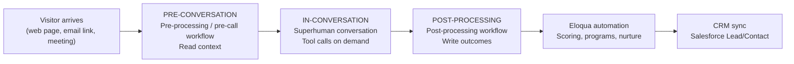

# 1mind + Oracle Eloqua Integration Guide

*Last updated October 8, 2026*

<aside>
ℹ️

**Audience:** Marketing Operations, Marketing Automation administrators, Revenue Operations, Salesforce/CRM administrators

**Purpose:** Step-by-step technical setup of the 1mind ↔ Eloqua integration, followed by how 1mind uses Eloqua before, during, and after a conversation, and the Contact and Custom Data Object (CDO) fields 1mind can write.

</aside>

---

## 1. Introduction

### 1.1 Overview

1mind deploys **Superhumans**  that hold real-time voice and chat conversations with website visitors, prospects, and . A Superhuman answers product questions, qualifies the buyer against the customer's own criteria, and books the right meeting. Every conversation produces structured output: a summary, a readable transcript, qualification and discovery signals, the meeting outcome, and attribution data.

The Eloqua integration connects that conversation output to the customer's marketing automation platform. 1mind writes approved data to Eloqua **Contacts** and to a dedicated **1mind Conversation Custom Data Object (CDO)**. Eloqua then does what it already does well: segmentation, lead scoring, Program Canvas and Campaign Canvas automation, nurture, alerts, and synchronization to Salesforce or another CRM.

1mind connects to Eloqua through the Eloqua REST API using **OAuth 2.0 (Authorization Code grant with refresh tokens)** issued by an Eloqua **AppCloud app** that the customer creates and owns.

### 1.2 What this guide covers

This guide is written for the Operations team that will build and own the integration. It is ordered the way the work happens:

| Part | What it covers | Primary reader |
| --- | --- | --- |
| **2. Technical Setup** | Integration user, AppCloud app, OAuth, base URL, the CDO, field preparation, connection testing | Eloqua administrator, 1mind implementation engineer |
| **3. The 1mind Conversation Lifecycle** | Pre-conversation, in-conversation, and post-processing stages, and where Eloqua participates in each | Marketing Ops, RevOps |
| **4. Use Cases** | Which use cases read from or write to Eloqua, and at which stage | Marketing Ops, RevOps, business owners |
| **5. Data Model and Field Options** | Contact fields and CDO fields 1mind can populate, limits, and write rules | Eloqua administrator |
| **6–10. Automation, testing, operations** | Eloqua automation patterns, acceptance tests, monitoring, go-live checklist, intake | Marketing Ops, 1mind |

This guide does not cover Superhuman persona design, content training, or website deployment. Those are handled in the 1mind onboarding process with the 1mind customer success team.

### 1.3 Guiding principle: keep your existing business workflow and write order

1mind is designed to fit into the customer's existing lead-management process, not to create a parallel one. **The first system 1mind writes to is the system where routing happens today.**

| Your current lead flow | 1mind's first write | What happens next | 1mind must not |
| --- | --- | --- | --- |
| **Eloqua routes first.** Leads are created, scored, and routed in Eloqua (lead scoring, Program Canvas, CDO services), then Eloqua's CRM integration creates or updates the Salesforce Lead/Contact. | **Eloqua** (Contact + 1mind Conversation CDO) | Eloqua's existing programs score and route the record and push it to Salesforce through the existing Eloqua-to-CRM integration, exactly as for a form fill. | Write the same Lead/Contact directly to Salesforce, which would bypass Eloqua routing and create duplicates or race conditions. |
| **The CRM routes first.** Leads are created in Salesforce (web-to-lead, assignment rules, LeanData, Distribution Engine, or similar), then the CRM syncs to Eloqua. | **Salesforce** (Lead/Contact, Task, or a 1mind conversation object), through the 1mind Salesforce connector | Salesforce assignment rules route the record; Eloqua receives the record through its normal CRM-to-Eloqua sync. | Create the Contact in Eloqua first, which would bypass CRM routing. 1mind may still write the **CDO** to Eloqua for marketing history if approved, but it does not create or route the person there. |
| **Hybrid.** Eloqua owns marketing qualification; the CRM owns sales assignment after hand-off. | Eloqua first | Eloqua qualifies and hands off; the CRM routes after hand-off. | Write sales-owned CRM fields (owner, status, opportunity) from 1mind unless the signed design delegates them. |

Confirm this decision in **Step 1** of the technical setup, before any credentials are created. It determines which connections 1mind builds and the order of writes in the post-processing workflow.

### 1.4 Setup at a glance

| # | Step | Owner | Output |
| --- | --- | --- | --- |
| 1 | Confirm write order and scope | Marketing Ops + RevOps + 1mind | Signed write-order decision |
| 2 | Create a dedicated Eloqua integration user | Eloqua admin | Integration user with API access |
| 3 | Create the 1mind AppCloud app (OAuth client) | Eloqua admin | Client ID, Client Secret |
| 4 | Record site name and pod base URL | Eloqua admin | Site name, base URL |
| 5 | Hand off credentials securely | Eloqua admin → 1mind Console | Credentials in 1mind vault |
| 6 | 1mind creates the OAuth credential | 1mind | Draft credential |
| 7 | Authorize the connection (OAuth consent) | Integration user | Stored refresh token |
| 8 | Create the 1mind Conversation CDO | Eloqua admin | CDO ID, field IDs |
| 9 | Prepare Contact fields | Eloqua admin | Approved Contact field list |
| 10 | 1mind configures the Eloqua connection | 1mind | Connection with endpoint mappings |
| 11 | Smoke-test the connection | 1mind + Eloqua admin | Verified read/write |
| 12 | Configure Eloqua automation | Marketing Ops | Programs and segments live |

---

## 2. Technical Setup

### Prerequisites

- Eloqua **Customer Administrator** access, or a user in a security group with **AppCloud Developer** access and permission to create Custom Objects and Contact fields.
- The Eloqua instance (production and, if available, a test instance) that will receive 1mind data.
- The signed write-order decision (Step 1).
- An approved list of Contact fields and CDO fields (see Part 5).
- A secure channel for credentials. Do not send the Client Secret by email, Slack, or support ticket; use the secure method provided by your 1mind implementation engineer.

### Step 1 — Confirm write order and scope

Answer these questions with Marketing Ops, RevOps, and the CRM administrator:

1. Where are new leads created and routed today: in Eloqua or in the CRM? (See section 1.3.)
2. Does Eloqua sync to Salesforce or another CRM? Through which integration (Oracle Eloqua Integration for Salesforce, CRM Integration App, other), and in which direction for each field?
3. May 1mind **create** net-new Eloqua Contacts, or only **update** existing ones?
4. Which stages will use Eloqua: pre-conversation context, in-conversation tool calls, post-processing writes, or a combination? (See Part 3.)
5. Which Eloqua programs, segments, or lead-scoring models will act on 1mind data?

**Output:** a one-page decision recorded in the customer's 1mind solution blueprint.

### Step 2 — Create a dedicated integration user

Create a named Eloqua user used only by 1mind. Using a dedicated user isolates permissions, keeps audit trails clean, and allows credential rotation without affecting other integrations.

1. Go to **Settings → Users** (under *Users and Security*) and create the user, for example `1mind Integration` with a monitored team mailbox.
2. Add the user to a security group that grants:
    - **API access** (for example, the standard *API Users* group, or a custom group with API permission).
    - Read and edit access to **Contacts**.
    - Read, create, and edit access to the **1mind Conversation CDO** (granted after Step 8).
    - **AppCloud Developer** access is needed only by the person who creates the app in Step 3, not by the integration user.
3. Do not share this user's password with 1mind. 1mind does not use the password grant; the user signs in once during the OAuth consent in Step 7.

<aside>
ℹ️

If your Eloqua instance uses SSO, confirm that the integration user can complete an interactive Eloqua sign-in. The OAuth consent screen requires it.

</aside>

### Step 3 — Create the 1mind AppCloud app (OAuth client)

The AppCloud app is the OAuth client that issues 1mind's Client ID and Client Secret.

1. Go to **Settings → Platform Extensions → AppCloud Developer**.
2. If prompted, register as a provider (company name `1mind` or your internal name for the integration, plus a support email).
3. Select **Create App** and complete the fields:

| Field | Value |
| --- | --- |
| **Name** | `1mind AI Conversations` |
| **Description** | `Writes 1mind AI conversation outcomes to Eloqua Contacts and the 1mind Conversation CDO.` |
| **Icon** | An HTTPS URL to a square image (1mind provides one on request). |
| **Enable URL** | Provided by your 1mind implementation engineer. 1mind does not use AppCloud lifecycle callbacks; the value is a required placeholder. |
| **Status URL** | Provided by your 1mind implementation engineer (same reason). |
| **OAuth Callback URL** | `https://launcher.1mind.com/v1/oauth/integration-credentials/callback` — must match exactly. Your 1mind engineer confirms this value for your 1mind environment before you save. |
1. Save the app. The app page now shows:
    - **Client ID** (also shown as App ID)
    - **Client Secret**
2. Leave the app in its default state. No installation into the Eloqua catalog is required; 1mind uses only the OAuth credentials.

### Step 4 — Record the site name and pod base URL

Eloqua hosts each customer on a pod. API calls must go to the pod's base URL, not to `login.eloqua.com`.

1. **Site (company) name:** the value entered in the *Company* box on the Eloqua sign-in page.
2. **Pod base URL:** one of the following:
    - Read the host from the browser address bar after signing in (for example `https://secure.p04.eloqua.com`).
    - Or, after authorization, call `GET https://login.eloqua.com/id` with the bearer token and read `urls.base` from the response. 1mind can run this check during Step 11.

Record both values. 1mind stores the base URL explicitly on the credential, because Eloqua's token response does not include it.

### Step 5 — Hand off the credentials securely

Enter the credentials into the  1mind console under the Integrations TAB with the following through the secure channel agreed with your implementation engineer:

| Value | Example | Sensitivity |
| --- | --- | --- |
| Client ID | `a1b2c3d4-…` | Confidential |
| Client Secret |   `• •••••••` | **Secret** |
| Site (company) name | `AcmeCorp` | Internal |
| Pod base URL | `https://secure.p04.eloqua.com` | Internal |
| Integration user name | `1mind.integration` | Internal |
| Environment | Production or Test | Internal |

### Step 6 — 1mind creates the OAuth credential

Customer creates an OAuth 2.0 credential in the customer's 1mind console workspace with these settings. They are listed here so Ops can review and audit the configuration.

| Setting | Value | Why |
| --- | --- | --- |
| Provider type | `oauth2` (Generic API connection) | Eloqua runs through 1mind's generic OAuth adapter. |
| Grant type | `authorization_code` | Eloqua's supported flow for server integrations; 1mind then refreshes tokens automatically. |
| Token host / path | `https://login.eloqua.com`  • `/auth/oauth2/token` | Eloqua token endpoint. |
| Authorize host / path | `https://login.eloqua.com`  • `/auth/oauth2/authorize` | Eloqua consent screen. |
| Client authentication | `client_secret_basic_unencoded` | Eloqua requires HTTP Basic client authentication with the raw `client_id:client_secret` pair. It rejects credentials posted in the body (HTTP 401) and rejects percent-encoded secrets (for example, secrets containing `~`). |
| Instance URL | The pod base URL from Step 4 | All data calls go to this host. |
| Scope | `full` (optional) | Eloqua's only scope. |

Tokens are sent as `Authorization: Bearer <access_token>` on every REST call.

### Step 7 — Authorize the connection (OAuth consent)

1. An **Authorize** link is generated from the 1mind console (Connections → Eloqua credential → *Authorize*).
2. The integration user opens the link, signs in to Eloqua with the site name and their credentials, and selects **Accept**.
3. Eloqua redirects to the 1mind callback URL. 1mind exchanges the authorization code for an access token and a refresh token and stores them encrypted.
4. The credential shows as **Authorized** in the 1mind console.

**Token lifecycle** (per Oracle documentation; confirm against your Eloqua release):

| Token | Lifetime | 1mind behavior |
| --- | --- | --- |
| Authorization code | About 60 seconds | Exchanged immediately at callback. |
| Access token | About 8 hours | Refreshed automatically when expired. Refreshes are serialized per credential. |
| Refresh token | Long-lived; rotated on use | 1mind stores the newest refresh token after every refresh. |

**Re-authorization is required** when the integration user is disabled or loses API access, the Client Secret is regenerated, the app is deleted, or the refresh token is revoked or expires. Repeat Step 7 to restore access.

### Step 8 — Create the 1mind Conversation Customer Data Object (CDO)

The CDO holds **one record per conversation**: the historical, reportable record of what happened. Contact fields hold only the latest state (see Part 5). There is a separate session where the 1mind implementation engineer works with the customer’s Marketing / Sales Ops team on all fields to be created. This is an example of the a subset of the fields.

1. Go to **Audience → Custom Objects** (older UI: **Audience → Tools → Custom Objects**) and select **Custom Object → New Custom Object**.
2. Name it `Conversation1mind or follow your company's object naming standards` and add a description.
3. Add the fields. Use the **core fields** in section 5.4 as the minimum; add optional field groups from section 5.5 as approved.
4. Configure the record settings in **Custom Object Record Fields** (or *Fields & Settings*):

| Setting | Value | Why |
| --- | --- | --- |
| **Unique Code Field** | `ConversationID` | Makes every conversation one record. 1mind looks up this field before writing, so a retry updates the existing record instead of creating a duplicate. |
| **Email Address Field** | `Email Address` | Lets Eloqua link the record to a Contact by email. |
| **Display Name Field** | `ConversationID` or `ConversationDate` | Readability in the Contact record view. |
| **Entity mapping** | **Map to Contacts**, matched on **Email Address** | Required for Contact-level segmentation and Program Canvas. |
1. Save. Then record:
    - The **CDO ID** (numeric, visible in the URL or via **Settings → Custom Objects**).
    - The **field ID** of every field (open each field, or ask 1mind to read them through the API in Step 11). 1mind writes CDO values by field ID.
2. Grant the integration user's security group read, create, and edit permission on the CDO.

<aside>
ℹ️

**Field length rules.** Eloqua *Text* fields hold a maximum of **250 characters**. Sending 251–255 characters returns HTTP 400. *Large Text* fields hold a maximum of **32,000 characters**. 1mind truncates every value to the field's limit before sending.

</aside>

### Step 9 — Prepare Contact fields

1. Decide which standard Contact fields 1mind may update (section 5.2) and whether 1mind may overwrite existing values.
2. If the design includes latest-state snapshot fields on the Contact (section 5.3), create them in **Settings → Fields & Views → Contact Fields → Add → Add Single Field**. Use a consistent prefix, for example `1mind – Qualification Status`.
3. For pick-list fields (for example *Country*), record the **option list** and the exact option **values**. 1mind writes the option value, not the display label. For example, a country option list may expect ISO-style codes such as `US`, `GB`, `DE`.
4. Confirm whether each field syncs to the CRM and in which direction. Fields that sync **from** the CRM must not be overwritten by 1mind if the CRM is the system of record.

### Step 10 — 1mind configures the Eloqua connection

1mind creates a Generic API connection that uses the credential from Step 6 and maps each Eloqua resource to its REST path. Ops does not configure this, but should review it.

| Resource | Operation | Method | Path (relative to the pod base URL) |
| --- | --- | --- | --- |
| Contact | Find by email | GET | `/api/REST/1.0/data/contacts?search=emailAddress='{email}'&depth=minimal` |
| Contact | Create | POST | `/api/REST/1.0/data/contact` |
| Contact | Update | PUT | `/api/REST/1.0/data/contact/{id}` |
| Conversation CDO | Find by conversation ID | GET | `/api/REST/2.0/data/customObject/{cdoId}/instances?search={uniqueField}='{conversationId}'` |
| Conversation CDO | Create | POST | `/api/REST/2.0/data/customObject/{cdoId}/instance` |
| Conversation CDO | Update | PUT | `/api/REST/2.0/data/customObject/{cdoId}/instance/{id}` |

Paths are shown as typically configured. The 1mind engineer confirms the REST API version (1.0 or 2.0) and the exact contact search expression (`emailAddress` or `C_EmailAddress`) against your instance during Step 11.

The **CDO find-by-conversation-ID mapping is required.** Without it, 1mind cannot check whether the record already exists, and the workflow stops before writing rather than risk a duplicate.

### Step 11 — Smoke-test the connection

1mind and the Eloqua administrator run these checks in the test instance first, then in production:

| # | Test | Expected result |
| --- | --- | --- |
| 1 | `GET https://login.eloqua.com/id` | Returns the site name, the integration user, and `urls.base` matching Step 4. |
| 2 | Find a known test Contact by email | Exactly one Contact returned. |
| 3 | Update a test field on the test Contact | Value visible in Eloqua; no other fields changed. |
| 4 | Create a CDO record for a test conversation ID | Record visible under the test Contact. |
| 5 | Re-send the same conversation ID | The **same** CDO record is updated; no second record. |
| 6 | Send a value longer than a Text field's limit | 1mind truncates; Eloqua returns success. |
| 7 | Run a full test conversation | Contact and CDO populated per the signed mapping. |

### Step 12 — Configure Eloqua automation

Configure the customer-owned Eloqua automation that reacts to 1mind data. See Part 6 for patterns. Do this after Step 11 so the automation is tested against real 1mind records.

---

## 3. The 1mind Conversation Lifecycle and Where Eloqua Is Used

Every 1mind deployment runs up to three kinds of workflows around a conversation. Each workflow can read from or write to connected systems.



### 3.1 Pre-conversation

**When it runs:** when the session starts, before the Superhuman speaks. For scheduled meetings, a pre-call workflow runs before the meeting.

**What it does:** gathers context so the Superhuman does not ask questions the business already knows. Inputs include URL parameters (UTM values, campaign IDs, a known email from an Eloqua email link), the visitor token, and CRM or marketing automation data.

**Eloqua's role (optional):** look up the Eloqua Contact by email when an email is known (for example, from an Eloqua email click-through with the email in the link). Typical fields read: name, company, title, country, lead score/rating, product interest, and 1mind snapshot fields from a prior conversation.

**Typical setup:** many customers read pre-conversation context from **Salesforce** (Lead, Contact, Account, Opportunity) rather than Eloqua, because the CRM holds ownership and opportunity data. Read Eloqua only when it holds context the CRM does not, such as marketing engagement or campaign membership.

### 3.2 In-conversation (tool calls)

**When it runs:** during the conversation, when the Superhuman decides it needs data or an action. Each tool call is a named workflow the Superhuman can invoke, for example `lookupContact` or `getBookingLink`.

**Eloqua's role (optional):**

| Tool call | What it does with Eloqua | When to use |
| --- | --- | --- |
| Returning-visitor lookup | Finds the Eloqua Contact once the visitor gives an email mid-conversation, then returns approved context to the Superhuman | The visitor was anonymous at session start |
| Subscription or preference check | Reads email-subscription status before the Superhuman offers to send content | Content follow-up and nurture use cases |

**Typical setup:** meeting routing and calendar selection usually run against **Salesforce** ownership and the booking tool, not Eloqua. Eloqua tool calls are added only when a use case requires them. Current production Eloqua deployments do not use Eloqua tool calls.

### 3.3 Post-processing

**When it runs:** after the conversation ends and 1mind has generated the summary, transcript, and extracted fields.

**What it does:** writes the outcome to the systems of record, in the order set by the write-order decision (section 1.3).

**Eloqua's role (primary):** this is where most Eloqua integrations do their work. The production post-processing sequence is:

| # | Action | Detail |
| --- | --- | --- |
| 1 | Guard | Stop if the conversation has no 1mind conversation ID; it is the CDO's unique key. |
| 2 | Find Contact | Look up the Eloqua Contact by email. Skipped when no email was captured. |
| 3 | Prepare Contact values | Normalize values to Eloqua formats (for example, country name → option-list code; state → postal abbreviation). |
| 4 | Update or create Contact | Update when found; create when not found **and** creation is approved. |
| 5 | Find CDO record | Look up the CDO by `1mind Conversation ID`. Stop if the lookup fails, to prevent duplicates. |
| 6 | Prepare CDO values | Build field values by field ID, truncate to limits, omit empty optional fields, apply approved placeholders. |
| 7 | Update or create CDO record | Update when the record exists (retry/replay); otherwise create. Link to the Contact by Contact ID and email. |
| 8 | Verify and report | Confirm a CDO record ID was returned; record the result for monitoring. A failed write on a booked meeting is flagged for follow-up. |

If the write-order decision is **CRM first**, 1mind writes Salesforce before step 2, and Eloqua steps 2–4 are removed (Eloqua receives the person through CRM sync). Steps 5–8 (the CDO) remain only if Eloqua marketing history is approved.

---

## 4. Use Cases and Where Eloqua Is Used

### 4.1 Use-case map

| Use case | Pre-conversation (read) | In-conversation (tool call) | Post-processing (write) | Eloqua automation afterwards |
| --- | --- | --- | --- | --- |
| **Website product expert** | Contact by email if known; otherwise anonymous | Optional returning-visitor lookup | Contact upsert + CDO with summary, topics, product interest | Score product interest; add to product nurture |
| **Inbound qualification and meeting booking** | CRM owner and routing context (Salesforce); Eloqua Contact optional | Booking link (CRM/booking tool) | Contact upsert + CDO with qualification, MEDDPICC fields, meeting date, owner ID | Program Canvas routes qualified records; CRM sync creates/updates the Lead |
| **Email or campaign follow-up** | Contact by email from the Eloqua email link; campaign from UTM | Optional subscription check | CDO with campaign/source URL, intent, next step | Change campaign path; suppress or accelerate nurture |
| **Event or webinar follow-up** | Contact and event-attendance context | — | CDO with key questions, product interest, qualification | Move attendees to post-event track; alert Sales on high intent |
| **Re-engagement of cold leads** | Contact plus prior 1mind snapshot fields | Optional returning-visitor lookup | Contact snapshot + CDO with re-engagement reason and objections | Re-score; notify existing owner via CRM sync |
| **Partner, support, or careers deflection** | — | — | CDO with status `PARTNER` / `SUPPORT` and summary | Route to partner or support program; exclude from sales scoring |
| **Sales follow-up content** | — | — | CDO with recommended opening, key quotes, follow-up email body | Sales cadence tool or Eloqua email uses the stored follow-up text |

### 4.2 Use-case detail

#### Inbound qualification and meeting booking

- **Business goal:** qualify the visitor and book a meeting with the right seller, with discovery already captured.
- **Pre-conversation:** read Salesforce ownership/routing context; read the Eloqua Contact only if Eloqua holds required context.
- **In-conversation:** booking-link tool call against the CRM owner or routing rules.
- **Post-processing (Eloqua-first design):** update/create the Contact; write the CDO with conversation status, qualification and discovery fields, meeting date, and the booked host's Salesforce User ID.
- **Eloqua automation:** a program listening for new 1mind CDO records with a booked meeting or qualified status sets lead status, updates the score, and lets the Eloqua-to-CRM integration create or update the Salesforce Lead with the correct owner.
- **Measure:** conversation-to-meeting rate, meeting show rate, accepted pipeline, time-to-first-touch.

#### Email or campaign follow-up

- **Business goal:** turn an email click into a conversation and capture intent.
- **Pre-conversation:** read the Contact by the email passed in the link; read UTM/campaign parameters.
- **Post-processing:** CDO with source URL, campaign context, topics, and next best action; Contact snapshot fields.
- **Eloqua automation:** branch the campaign path on CDO values; route high-intent records to Sales.
- **Measure:** click-to-conversation rate, conversation-to-qualified rate, nurture progression.

#### Partner, support, or careers deflection

- **Business goal:** keep non-sales conversations out of sales routing.
- **Post-processing:** CDO with a normalized conversation status (for example `PARTNER`) and summary; no lead-score change.
- **Eloqua automation:** route to the partner or support program; exclude from MQL logic.
- **Measure:** correct-route rate, reduction in seller noise.

---

## 5. Data Model and Field Options

### 5.1 Contact fields or CDO?

| Eloqua record | Holds | Lifecycle | Use for |
| --- | --- | --- | --- |
| **Contact fields** | Identity and the **latest** 1mind state | Overwritten each conversation | Segmentation, lead scoring, CRM sync, personalization |
| **1mind Conversation CDO** | **One record per conversation** with full detail | Created once; updated only on retry or replay | History, reporting, Program Canvas triggers, sales follow-up content |
| **External transcript (1mind)** | Full transcript and recording | Governed by retention policy | Audit and review; the CDO stores a readable transcript up to 32,000 characters |

**Recommended default:** standard Contact fields + a small set of 1mind snapshot fields on the Contact + the 1mind Conversation CDO for everything conversation-specific.

### 5.2 Contact — standard fields

1mind writes standard Contact fields through the Eloqua REST contact model.

| Eloqua field | Internal name | REST attribute | 1mind source | Default write rule |
| --- | --- | --- | --- | --- |
| Email Address | `C_EmailAddress` | `emailAddress` | Email captured in conversation, else the email passed in the URL | **Match key.** Never overwritten. |
| First Name | `C_FirstName` | `firstName` | Captured first name | Write if empty (or overwrite, if approved) |
| Last Name | `C_LastName` | `lastName` | Captured last name | Write if empty (or overwrite, if approved) |
| Company | `C_Company` | `accountName` | Captured company | Write if empty |
| Title | `C_Title` | `title` | Captured role/title | Write if empty |
| Business Phone | `C_BusPhone` | `businessPhone` | Captured phone | Write if empty |
| Country | `C_Country` | `country` | Captured country, converted to the option-list value | Write if empty; must match option list |
| State or Province | `C_State_Prov` | `province` | Captured state, as a postal abbreviation | Write if empty |
| City | `C_City` | `city` | Captured city | Optional |

### 5.3 Contact — optional 1mind snapshot fields

Create these as custom Contact fields only if Eloqua segmentation or scoring needs the latest 1mind state on the Contact. Custom Contact fields are written by field ID.

| Suggested display name | Type | 1mind source | Purpose |
| --- | --- | --- | --- |
| 1mind – Last Conversation ID | Text | Conversation ID | Correlation with the CDO and 1mind |
| 1mind – Last Conversation Date | Date | Conversation date | Recency segmentation |
| 1mind – Qualification Status | Text or pick list | Qualification outcome (for example `Qualified`, `Nurture`, `Disqualified`, `Partner`, `Support`) | Scoring and routing |
| 1mind – Primary Intent | Text | Extracted primary intent | Segmentation |
| 1mind – Product Interest | Text | Extracted products | Nurture track selection |
| 1mind – Meeting Booked | Text (`true`/`false`) | Booking outcome | Suppress nurture after booking |
| 1mind – Last Summary | Large Text | Conversation summary (≤ 32,000) | Personalization and sales view |
| 1mind – Times Engaged | Numeric | Count of conversations | Engagement scoring |

### 5.4 1mind Conversation CDO — core fields (required)

| CDO field | Type | Max | 1mind source | Notes |
| --- | --- | --- | --- | --- |
| **1mind Conversation ID** | Text | 100 | Session ID | **Unique Code Field.** Upsert key. Required. |
| **Email Address** | Text | 250 | Contact email | **Email Address Field** for Contact linkage. If no email was captured, 1mind writes an approved placeholder (for example `no-email-<conversationId>@example.com`) or skips the record, per the signed design. |
| Conversation Date | Date | — | Conversation start time | Sent as epoch seconds. |
| Conversation Status | Text | 250 | Extracted status (`QUALIFIED`, `NURTURE`, `PARTNER`, …) | Normalized to approved values. |
| Conversation Summary | Large Text | 5,000 | Summary | Business-readable. |
| Conversation Transcript | Large Text | 32,000 | Readable transcript | Capped at 32,000; the full transcript remains in 1mind. |
| Source URL | Text | 250 | Page URL, else referrer | Truncated to 250. |
| Duration (seconds) | Numeric | — | Conversation duration |  |
| Turns | Numeric | — | Number of exchanges |  |
| Environment | Text | 250 | Deployment environment | Separates test and production records. |
| 1mind Visitor Token | Text | 100 | Visitor token | Links repeat visits. |

### 5.5 1mind Conversation CDO — optional field groups

Choose the groups that match the approved use cases. Each field is optional; empty values are omitted, or written with an approved placeholder such as `Not provided` so reporting can distinguish "not discussed" from "not processed."

**Identity (for records without a Contact match)**

| Field | Type | Max | Source |
| --- | --- | --- | --- |
| First Name | Text | 250 | Captured first name (placeholder `Anonymous`) |
| Last Name | Text | 250 | Captured last name (placeholder `Visitor`) |

**Qualification and discovery**

| Field | Type | Max | Source |
| --- | --- | --- | --- |
| Pain Points | Large Text | 3,000 | Extracted pain points |
| Current Solution / Incumbent | Text | 250 | Extracted incumbent |
| Tech Stack Mentioned | Large Text | 1,000 | Extracted tech stack |
| Volume / Scale | Text | 250 | Extracted volume |
| Integration Requirements | Large Text | 1,000 | Extracted integrations |
| Products Interested | Text | 100–250 | Extracted products |
| Use Cases Identified | Large Text | 1,000 | Extracted use cases |
| Budget Range | Text | 250 | Extracted budget |
| Existing Contract End | Date | — | Extracted date (omitted if empty) |
| Persona Match | Text | 250 | Matched persona |

**MEDDPICC (or the customer's qualification framework)**

| Field | Type | Max |
| --- | --- | --- |
| Metrics | Large Text | 1,000 |
| Economic Buyer | Text | 250 |
| Decision Criteria | Large Text | 1,000 |
| Decision Process | Large Text | 1,000 |
| Paper Process | Large Text | 1,000 |
| Identify Pain | Large Text | 1,000 |
| Champion | Text | 250 |
| Competition | Text | 250 |

**Objections and risk**

| Field | Type | Max |
| --- | --- | --- |
| Objections Raised | Large Text | 2,000 |
| Concerns About Vendor | Large Text | 1,000 |
| Unanswered Questions | Large Text | 2,000 |

**Meeting and hand-off**

| Field | Type | Max | Source |
| --- | --- | --- | --- |
| Meeting Date | Date | — | Booked meeting start (only when a meeting was booked) |
| Demo Requested | Text | — | `true` / `false` |
| POC Requested | Text | — | `true` / `false` |
| Trial Requested | Text | — | `true` / `false` |
| SFDC Lead Owner ID | Text | 250 | Salesforce User ID of the booked host (booked meetings only) |

## Appendix A — Eloqua REST reference used by 1mind

**Contact search**

```
GET {baseUrl}/api/REST/1.0/data/contacts?search=emailAddress='jane@example.com'&depth=minimal
Authorization: Bearer {access_token}
```

Response: `{ "elements": [ { "id": "12345", ... } ], "total": 1 }`

**Contact update**

```
PUT {baseUrl}/api/REST/1.0/data/contact/12345
Content-Type: application/json

{
  "id": "12345",
  "emailAddress": "jane@example.com",
  "firstName": "Jane",
  "lastName": "Doe",
  "accountName": "Acme Corp",
  "title": "VP Operations",
  "businessPhone": "+1 555 0100",
  "country": "US",
  "province": "CA",
  "fieldValues": [ { "type": "FieldValue", "id": "100250", "value": "Qualified" } ]
}
```

**CDO lookup by conversation ID**

```
GET {baseUrl}/api/REST/2.0/data/customObject/{cdoId}/instances?search=1mind_Conversation_ID1='c0a8-…'
```

**CDO create**

```
POST {baseUrl}/api/REST/2.0/data/customObject/{cdoId}/instance
Content-Type: application/json

{
  "type": "CustomObjectData",
  "contactId": "12345",
  "fieldValues": [
    { "type": "FieldValue", "id": "2067", "value": "c0a8-…" },
    { "type": "FieldValue", "id": "1975", "value": "jane@example.com" },
    { "type": "FieldValue", "id": "2032", "value": "Jane asked about…" }
  ]
}
```

**CDO update:** `PUT {baseUrl}/api/REST/2.0/data/customObject/{cdoId}/instance/{instanceId}` with the same body plus `"id": "{instanceId}"`.

Field IDs above are illustrative. Use the IDs from your CDO.