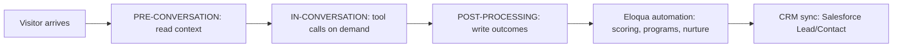

<Note>
  **Audience:** Marketing Operations, Marketing Automation administrators, Revenue Operations, Salesforce/CRM administrators.
  **Purpose:** Step-by-step technical setup of the 1mind ↔ Eloqua integration, followed by how 1mind uses Eloqua before, during, and after a conversation, and the Contact and Custom Data Object (CDO) fields 1mind can write.
</Note>

## 1. Introduction

### 1.1 Overview

1mind deploys **Superhumans** that hold real-time voice and chat conversations with website visitors, prospects, and customers. A Superhuman answers product questions, qualifies the buyer against the customer's own criteria, and books the right meeting. Every conversation produces structured output: a summary, a readable transcript, qualification and discovery signals, the meeting outcome, and attribution data.

The Eloqua integration connects that conversation output to the customer's marketing automation platform. 1mind writes approved data to Eloqua **Contacts** and to a dedicated **1mind Conversation Custom Data Object (CDO)**. Eloqua then does what it already does well: segmentation, lead scoring, Program Canvas and Campaign Canvas automation, nurture, alerts, and synchronization to Salesforce or another CRM.

1mind connects to Eloqua through the Eloqua REST API using **OAuth 2.0 (Authorization Code grant with refresh tokens)** issued by an Eloqua **AppCloud app** that the customer creates and owns.

### 1.2 What this guide covers

| Part | What it covers | Primary reader |
| --- | --- | --- |
| **2. Technical Setup** | Integration user, AppCloud app, OAuth, base URL, the CDO, field preparation, connection testing | Eloqua administrator, 1mind implementation engineer |
| **3. The 1mind Conversation Lifecycle** | Pre-conversation, in-conversation, and post-processing stages, and where Eloqua participates in each | Marketing Ops, RevOps |
| **4. Use Cases** | Which use cases read from or write to Eloqua, and at which stage | Marketing Ops, RevOps, business owners |
| **5. Data Model and Field Options** | Contact fields and CDO fields 1mind can populate, limits, and write rules | Eloqua administrator |
| **6–10. Automation, testing, operations** | Eloqua automation patterns, acceptance tests, monitoring, go-live checklist, intake | Marketing Ops, 1mind |

This guide does not cover Superhuman persona design, content training, or website deployment. Those are handled in the 1mind onboarding process with the 1mind customer success team.

### 1.3 Guiding principle: keep your existing workflow and write order

1mind is designed to fit into the customer's existing lead-management process, not to create a parallel one. **The first system 1mind writes to is the system where routing happens today.**

| Your current lead flow | 1mind's first write | What happens next | 1mind must not |
| --- | --- | --- | --- |
| **Eloqua routes first.** Leads are created, scored, and routed in Eloqua (lead scoring, Program Canvas, CDO services), then Eloqua's CRM integration creates or updates the Salesforce Lead/Contact. | **Eloqua** (Contact + 1mind Conversation CDO) | Eloqua's existing programs score and route the record and push it to Salesforce through the existing Eloqua-to-CRM integration, exactly as for a form fill. | Write the same Lead/Contact directly to Salesforce, which would bypass Eloqua routing and create duplicates or race conditions. |
| **The CRM routes first.** Leads are created in Salesforce (web-to-lead, assignment rules, LeanData, Distribution Engine), then the CRM syncs to Eloqua. | **Salesforce** (Lead/Contact, Task, or a 1mind conversation object), through the 1mind Salesforce connector | Salesforce assignment rules route the record; Eloqua receives it through its normal CRM-to-Eloqua sync. | Create the Contact in Eloqua first, which would bypass CRM routing. 1mind may still write the **CDO** for marketing history if approved, but it does not create or route the person there. |
| **Hybrid.** Eloqua owns marketing qualification; the CRM owns sales assignment after hand-off. | Eloqua first | Eloqua qualifies and hands off; the CRM routes after hand-off. | Write sales-owned CRM fields (owner, status, opportunity) unless the signed design delegates them. |

Confirm this decision in **Step 1** of the technical setup, before any credentials are created. It determines which connections 1mind builds and the order of writes in post-processing.

### 1.4 Setup at a glance

| # | Step | Owner | Output |
| --- | --- | --- | --- |
| 1 | Confirm write order and scope | Marketing Ops + RevOps + 1mind | Signed write-order decision |
| 2 | Create a dedicated Eloqua integration user | Eloqua admin | Integration user with API access |
| 3 | Create the 1mind AppCloud app (OAuth client) | Eloqua admin | Client ID, Client Secret |
| 4 | Record site name and pod base URL | Eloqua admin | Site name, base URL |
| 5 | Hand off credentials securely | Eloqua admin → 1mind Console | Credentials in 1mind vault |
| 6 | Create the OAuth credential | 1mind | Draft credential |
| 7 | Authorize the connection (OAuth consent) | Integration user | Stored refresh token |
| 8 | Create the 1mind Conversation CDO | Eloqua admin | CDO ID, field IDs |
| 9 | Prepare Contact fields | Eloqua admin | Approved Contact field list |
| 10 | 1mind configures the Eloqua connection | 1mind | Connection with endpoint mappings |
| 11 | Smoke-test the connection | 1mind + Eloqua admin | Verified read/write |
| 12 | Configure Eloqua automation | Marketing Ops | Programs and segments live |

## 2. Technical setup

### Prerequisites

- Eloqua **Customer Administrator** access, or a user with **AppCloud Developer** access and permission to create Custom Objects and Contact fields.
- The Eloqua instance (production and, if available, a test instance) that will receive 1mind data.
- The signed write-order decision (Step 1).
- An approved list of Contact fields and CDO fields (Part 5).
- A secure channel for credentials. Do not send the Client Secret by email, Slack, or support ticket; use the secure method provided by your 1mind implementation engineer.

<Steps>
  <Step title="Confirm write order and scope">
    With Marketing Ops, RevOps, and the CRM administrator, confirm: where leads are created and routed today (Eloqua or CRM); whether and how Eloqua syncs to the CRM, and the direction per field; whether 1mind may **create** net-new Contacts or only **update**; which stages use Eloqua; and which Eloqua programs, segments, or scoring models act on 1mind data. **Output:** a one-page decision recorded in the customer's 1mind solution blueprint.
  </Step>
  <Step title="Create a dedicated integration user">
    Create a named Eloqua user used only by 1mind, under **Settings → Users** (e.g. `1mind Integration` with a monitored team mailbox). Add it to a security group granting **API access**, read/edit on **Contacts**, and read/create/edit on the **1mind Conversation CDO** (granted after Step 8). Do not share the password with 1mind — the user signs in once during OAuth consent in Step 7.

    <Note>If your Eloqua instance uses SSO, confirm the integration user can complete an interactive Eloqua sign-in. The OAuth consent screen requires it.</Note>
  </Step>
  <Step title="Create the 1mind AppCloud app (OAuth client)">
    Go to **Settings → Platform Extensions → AppCloud Developer**, register as a provider if prompted, and **Create App** with:

    | Field | Value |
    | --- | --- |
    | **Name** | `1mind AI Conversations` |
    | **Description** | `Writes 1mind AI conversation outcomes to Eloqua Contacts and the 1mind Conversation CDO.` |
    | **Icon** | An HTTPS URL to a square image (1mind provides one on request) |
    | **Enable URL** | Provided by your 1mind engineer (required placeholder; 1mind does not use AppCloud lifecycle callbacks) |
    | **Status URL** | Provided by your 1mind engineer (same reason) |
    | **OAuth Callback URL** | `https://launcher.1mind.com/v1/oauth/integration-credentials/callback` — must match exactly; confirm the value for your 1mind environment before saving |

    Save the app and record the **Client ID** and **Client Secret**. No catalog installation is required; 1mind uses only the OAuth credentials.
  </Step>
  <Step title="Record the site name and pod base URL">
    Eloqua hosts each customer on a pod; API calls must go to the pod's base URL, not `login.eloqua.com`. Record the **site (company) name** (from the *Company* box on the sign-in page) and the **pod base URL** (e.g. `https://secure.p04.eloqua.com`, read from the address bar after sign-in, or from `GET https://login.eloqua.com/id` → `urls.base`). 1mind stores the base URL explicitly, because Eloqua's token response does not include it.
  </Step>
  <Step title="Hand off the credentials securely">
    Enter the following into the 1mind console under the Integrations tab, through the secure channel agreed with your implementation engineer:

    | Value | Example | Sensitivity |
    | --- | --- | --- |
    | Client ID | `a1b2c3d4-...` | Confidential |
    | Client Secret | `••••••••` | **Secret** |
    | Site (company) name | `AcmeCorp` | Internal |
    | Pod base URL | `https://secure.p04.eloqua.com` | Internal |
    | Integration user name | `1mind.integration` | Internal |
    | Environment | Production or Test | Internal |
  </Step>
  <Step title="Create the OAuth credential">
    An OAuth 2.0 credential is created in the customer's 1mind console workspace (listed so Ops can review and audit it):

    | Setting | Value | Why |
    | --- | --- | --- |
    | Provider type | `oauth2` (Generic API connection) | Eloqua runs through 1mind's generic OAuth adapter |
    | Grant type | `authorization_code` | Eloqua's supported server flow; 1mind refreshes tokens automatically |
    | Token host / path | `https://login.eloqua.com` · `/auth/oauth2/token` | Eloqua token endpoint |
    | Authorize host / path | `https://login.eloqua.com` · `/auth/oauth2/authorize` | Eloqua consent screen |
    | Client authentication | `client_secret_basic_unencoded` | Eloqua requires HTTP Basic auth with the raw `client_id:client_secret` pair; it rejects body credentials (HTTP 401) and percent-encoded secrets |
    | Instance URL | The pod base URL from Step 4 | All data calls go to this host |
    | Scope | `full` (optional) | Eloqua's only scope |

    Tokens are sent as `Authorization: Bearer <access_token>` on every REST call.
  </Step>
  <Step title="Authorize the connection (OAuth consent)">
    Generate the **Authorize** link in the 1mind console (Connections → Eloqua credential → *Authorize*). The integration user opens it, signs in to Eloqua with the site name and their credentials, and selects **Accept**. Eloqua redirects to the 1mind callback; 1mind exchanges the code for access and refresh tokens and stores them encrypted. The credential then shows **Authorized**.

    Token lifecycle (per Oracle documentation; confirm against your release): authorization code ~60 seconds (exchanged immediately); access token ~8 hours (refreshed automatically, serialized per credential); refresh token long-lived and rotated on use (1mind stores the newest after every refresh). **Re-authorization is required** if the integration user is disabled or loses API access, the Client Secret is regenerated, the app is deleted, or the refresh token is revoked or expires.
  </Step>
  <Step title="Create the 1mind Conversation Custom Data Object (CDO)">
    The CDO holds **one record per conversation** — the historical, reportable record. Contact fields hold only the latest state (Part 5). A separate session covers the full field list with your Marketing/Sales Ops team; the fields here are an example subset.

    Under **Audience → Custom Objects → New Custom Object**, name it (e.g. `Conversation1mind`, or follow your object naming standards), add the **core fields** from section 5.4 (plus approved optional groups), and configure:

    | Setting | Value | Why |
    | --- | --- | --- |
    | **Unique Code Field** | `ConversationID` | Makes every conversation one record; a retry updates the existing record instead of duplicating |
    | **Email Address Field** | `Email Address` | Lets Eloqua link the record to a Contact by email |
    | **Display Name Field** | `ConversationID` or `ConversationDate` | Readability in the Contact record view |
    | **Entity mapping** | **Map to Contacts**, matched on **Email Address** | Required for Contact-level segmentation and Program Canvas |

    Record the **CDO ID** and the **field ID** of every field (1mind writes CDO values by field ID), and grant the integration user's security group read/create/edit on the CDO.

    <Note>**Field length rules.** Eloqua *Text* fields hold a maximum of **250 characters** (251+ returns HTTP 400). *Large Text* fields hold up to **32,000 characters**. 1mind truncates every value to the field's limit before sending.</Note>
  </Step>
  <Step title="Prepare Contact fields">
    Decide which standard Contact fields 1mind may update (section 5.2) and whether it may overwrite existing values. If the design includes latest-state snapshot fields on the Contact (section 5.3), create them under **Settings → Fields & Views → Contact Fields** with a consistent prefix (e.g. `1mind – Qualification Status`). For pick-list fields, record the exact option **values** (1mind writes the value, not the label — e.g. ISO-style country codes `US`, `GB`, `DE`). Confirm CRM sync direction per field; fields that sync **from** the CRM must not be overwritten by 1mind if the CRM is the system of record.
  </Step>
  <Step title="1mind configures the Eloqua connection">
    1mind creates a Generic API connection that maps each Eloqua resource to its REST path (review only):

    | Resource | Operation | Method | Path (relative to the pod base URL) |
    | --- | --- | --- | --- |
    | Contact | Find by email | GET | `/api/REST/1.0/data/contacts?search=emailAddress='{email}'&depth=minimal` |
    | Contact | Create | POST | `/api/REST/1.0/data/contact` |
    | Contact | Update | PUT | `/api/REST/1.0/data/contact/{id}` |
    | Conversation CDO | Find by conversation ID | GET | `/api/REST/2.0/data/customObject/{cdoId}/instances?search={uniqueField}='{conversationId}'` |
    | Conversation CDO | Create | POST | `/api/REST/2.0/data/customObject/{cdoId}/instance` |
    | Conversation CDO | Update | PUT | `/api/REST/2.0/data/customObject/{cdoId}/instance/{id}` |

    The 1mind engineer confirms the REST version and the exact contact search expression against your instance. The **CDO find-by-conversation-ID mapping is required** — without it, 1mind cannot check for an existing record and stops before writing rather than risk a duplicate.
  </Step>
  <Step title="Smoke-test the connection">
    Run in the test instance first, then production: `GET https://login.eloqua.com/id` returns the site, user, and `urls.base`; find a known Contact by email; update a test field; create a CDO record for a test conversation ID; re-send the same ID (same record updated, no duplicate); send an over-limit value (1mind truncates, write succeeds); run a full test conversation.
  </Step>
  <Step title="Configure Eloqua automation">
    Configure the customer-owned Eloqua automation that reacts to 1mind data (Part 6), after the connection is verified so automation is tested against real 1mind records.
  </Step>
</Steps>

## 3. The 1mind conversation lifecycle and where Eloqua is used

Every 1mind deployment runs up to three kinds of workflows around a conversation; each can read from or write to connected systems.



### 3.1 Pre-conversation

**When it runs:** when the session starts, before the Superhuman speaks (a pre-call workflow runs before a scheduled meeting). **What it does:** gathers context — URL parameters (UTM, campaign IDs, a known email from an Eloqua email link), the visitor token, and CRM or marketing-automation data. **Eloqua's role (optional):** look up the Eloqua Contact by email when one is known; typical fields read are name, company, title, country, lead score/rating, product interest, and 1mind snapshot fields from a prior conversation. Many customers read pre-conversation context from **Salesforce** instead, because the CRM holds ownership and opportunity data; read Eloqua only when it holds context the CRM does not.

### 3.2 In-conversation (tool calls)

| Tool call | What it does with Eloqua | When to use |
| --- | --- | --- |
| Returning-visitor lookup | Finds the Eloqua Contact once the visitor gives an email mid-conversation, then returns approved context | The visitor was anonymous at session start |
| Subscription or preference check | Reads email-subscription status before the Superhuman offers to send content | Content follow-up and nurture use cases |

Meeting routing and calendar selection usually run against **Salesforce** ownership and the booking tool, not Eloqua. Current production Eloqua deployments do not use Eloqua tool calls.

### 3.3 Post-processing

**When it runs:** after the conversation ends and 1mind has generated the summary, transcript, and extracted fields. **What it does:** writes the outcome in the order set by the write-order decision (section 1.3). This is where most Eloqua integrations do their work:

| # | Action | Detail |
| --- | --- | --- |
| 1 | Guard | Stop if there is no 1mind conversation ID (the CDO's unique key). |
| 2 | Find Contact | Look up the Eloqua Contact by email. Skipped when no email was captured. |
| 3 | Prepare Contact values | Normalize to Eloqua formats (country → option-list code; state → postal abbreviation). |
| 4 | Update or create Contact | Update when found; create when not found **and** creation is approved. |
| 5 | Find CDO record | Look up the CDO by `1mind Conversation ID`. Stop if the lookup fails, to prevent duplicates. |
| 6 | Prepare CDO values | Build values by field ID, truncate to limits, omit empty optional fields, apply approved placeholders. |
| 7 | Update or create CDO record | Update when the record exists (retry/replay); otherwise create. Link to the Contact by Contact ID and email. |
| 8 | Verify and report | Confirm a CDO record ID was returned; record the result for monitoring. A failed write on a booked meeting is flagged. |

If the write-order decision is **CRM first**, 1mind writes Salesforce before step 2, and Eloqua steps 2–4 are removed (Eloqua receives the person through CRM sync). Steps 5–8 (the CDO) remain only if Eloqua marketing history is approved.

## 4. Use cases and where Eloqua is used

| Use case | Pre-conversation (read) | In-conversation (tool call) | Post-processing (write) | Eloqua automation afterwards |
| --- | --- | --- | --- | --- |
| **Website product expert** | Contact by email if known; otherwise anonymous | Optional returning-visitor lookup | Contact upsert + CDO with summary, topics, product interest | Score product interest; add to product nurture |
| **Inbound qualification and meeting booking** | CRM owner and routing context; Eloqua Contact optional | Booking link (CRM/booking tool) | Contact upsert + CDO with qualification, MEDDPICC fields, meeting date, owner ID | Program Canvas routes qualified records; CRM sync creates/updates the Lead |
| **Email or campaign follow-up** | Contact by email from the Eloqua email link; campaign from UTM | Optional subscription check | CDO with campaign/source URL, intent, next step | Change campaign path; suppress or accelerate nurture |
| **Event or webinar follow-up** | Contact and event-attendance context | — | CDO with key questions, product interest, qualification | Move attendees to post-event track; alert Sales on high intent |
| **Re-engagement of cold leads** | Contact plus prior 1mind snapshot fields | Optional returning-visitor lookup | Contact snapshot + CDO with re-engagement reason and objections | Re-score; notify existing owner via CRM sync |
| **Partner, support, or careers deflection** | — | — | CDO with status `PARTNER` / `SUPPORT` and summary | Route to partner/support program; exclude from sales scoring |
| **Sales follow-up content** | — | — | CDO with recommended opening, key quotes, follow-up email body | Sales cadence tool or Eloqua email uses the stored follow-up text |

### 4.2 Use-case detail

**Inbound qualification and meeting booking** — qualify the visitor and book a meeting with discovery already captured. Pre-conversation reads Salesforce ownership/routing; in-conversation uses a booking-link tool call; post-processing (Eloqua-first) updates/creates the Contact and writes the CDO with status, qualification and discovery fields, meeting date, and the booked host's Salesforce User ID; a program listening for new 1mind CDO records with a booked meeting sets lead status, updates score, and lets the Eloqua-to-CRM integration create/update the Lead with the correct owner. Measure conversation-to-meeting rate, show rate, accepted pipeline, time-to-first-touch.

**Email or campaign follow-up** — turn an email click into a conversation and capture intent. Reads the Contact by the email in the link plus UTM/campaign; post-processing writes the CDO with source URL, campaign context, topics, and next best action; automation branches the campaign path on CDO values and routes high-intent records to Sales.

**Partner, support, or careers deflection** — keep non-sales conversations out of sales routing. Post-processing writes the CDO with a normalized status (e.g. `PARTNER`) and summary and no lead-score change; automation routes to the partner/support program and excludes from MQL logic.

## 5. Data model and field options

### 5.1 Contact fields or CDO?

| Eloqua record | Holds | Lifecycle | Use for |
| --- | --- | --- | --- |
| **Contact fields** | Identity and the **latest** 1mind state | Overwritten each conversation | Segmentation, lead scoring, CRM sync, personalization |
| **1mind Conversation CDO** | **One record per conversation** with full detail | Created once; updated only on retry or replay | History, reporting, Program Canvas triggers, sales follow-up content |
| **External transcript (1mind)** | Full transcript and recording | Governed by retention policy | Audit and review; the CDO stores a readable transcript up to 32,000 characters |

**Recommended default:** standard Contact fields + a small set of 1mind snapshot fields on the Contact + the 1mind Conversation CDO for everything conversation-specific.

### 5.2 Contact — standard fields

| Eloqua field | Internal name | REST attribute | 1mind source | Default write rule |
| --- | --- | --- | --- | --- |
| Email Address | `C_EmailAddress` | `emailAddress` | Email captured in conversation, else email passed in the URL | **Match key.** Never overwritten. |
| First Name | `C_FirstName` | `firstName` | Captured first name | Write if empty (or overwrite, if approved) |
| Last Name | `C_LastName` | `lastName` | Captured last name | Write if empty (or overwrite, if approved) |
| Company | `C_Company` | `accountName` | Captured company | Write if empty |
| Title | `C_Title` | `title` | Captured role/title | Write if empty |
| Business Phone | `C_BusPhone` | `businessPhone` | Captured phone | Write if empty |
| Country | `C_Country` | `country` | Captured country, converted to the option-list value | Write if empty; must match option list |
| State or Province | `C_State_Prov` | `province` | Captured state, as a postal abbreviation | Write if empty |
| City | `C_City` | `city` | Captured city | Optional |

### 5.3 Contact — optional 1mind snapshot fields

Create these as custom Contact fields only if Eloqua segmentation or scoring needs the latest 1mind state on the Contact. Custom Contact fields are written by field ID.

| Suggested display name | Type | 1mind source | Purpose |
| --- | --- | --- | --- |
| 1mind – Last Conversation ID | Text | Conversation ID | Correlation with the CDO and 1mind |
| 1mind – Last Conversation Date | Date | Conversation date | Recency segmentation |
| 1mind – Qualification Status | Text or pick list | Qualification outcome (`Qualified`, `Nurture`, `Disqualified`, `Partner`, `Support`) | Scoring and routing |
| 1mind – Primary Intent | Text | Extracted primary intent | Segmentation |
| 1mind – Product Interest | Text | Extracted products | Nurture track selection |
| 1mind – Meeting Booked | Text (`true`/`false`) | Booking outcome | Suppress nurture after booking |
| 1mind – Last Summary | Large Text | Conversation summary (≤ 32,000) | Personalization and sales view |
| 1mind – Times Engaged | Numeric | Count of conversations | Engagement scoring |

### 5.4 1mind Conversation CDO — core fields (required)

| CDO field | Type | Max | 1mind source | Notes |
| --- | --- | --- | --- | --- |
| **1mind Conversation ID** | Text | 100 | Session ID | **Unique Code Field.** Upsert key. Required. |
| **Email Address** | Text | 250 | Contact email | **Email Address Field** for Contact linkage. If no email was captured, 1mind writes an approved placeholder or skips the record, per the signed design. |
| Conversation Date | Date | — | Conversation start time | Sent as epoch seconds. |
| Conversation Status | Text | 250 | Extracted status (`QUALIFIED`, `NURTURE`, `PARTNER`, …) | Normalized to approved values. |
| Conversation Summary | Large Text | 5,000 | Summary | Business-readable. |
| Conversation Transcript | Large Text | 32,000 | Readable transcript | Capped at 32,000; the full transcript remains in 1mind. |
| Source URL | Text | 250 | Page URL, else referrer | Truncated to 250. |
| Duration (seconds) | Numeric | — | Conversation duration | |
| Turns | Numeric | — | Number of exchanges | |
| Environment | Text | 250 | Deployment environment | Separates test and production records. |
| 1mind Visitor Token | Text | 100 | Visitor token | Links repeat visits. |

### 5.5 1mind Conversation CDO — optional field groups

Choose the groups that match the approved use cases. Each field is optional; empty values are omitted, or written with an approved placeholder such as `Not provided` so reporting can distinguish "not discussed" from "not processed."

**Qualification and discovery:** Pain Points (Large Text, 3,000), Current Solution / Incumbent (Text, 250), Tech Stack Mentioned (Large Text, 1,000), Volume / Scale (Text, 250), Integration Requirements (Large Text, 1,000), Products Interested (Text), Use Cases Identified (Large Text, 1,000), Budget Range (Text, 250), Existing Contract End (Date), Persona Match (Text, 250).

**MEDDPICC (or your qualification framework):** Metrics, Decision Criteria, Decision Process, Paper Process, Identify Pain (Large Text, 1,000 each); Economic Buyer, Champion, Competition (Text, 250 each).

**Objections and risk:** Objections Raised (Large Text, 2,000), Concerns About Vendor (Large Text, 1,000), Unanswered Questions (Large Text, 2,000).

**Meeting and hand-off:** Meeting Date (Date, booked meetings only), Demo Requested / POC Requested / Trial Requested (`true`/`false`), SFDC Lead Owner ID (Text, 250 — Salesforce User ID of the booked host).

## Appendix A — Eloqua REST reference used by 1mind

**Contact search**

```text
GET {baseUrl}/api/REST/1.0/data/contacts?search=emailAddress='jane@example.com'&depth=minimal
Authorization: Bearer {access_token}
```

Response: `{ "elements": [ { "id": "12345", ... } ], "total": 1 }`

**Contact update**

```json
PUT {baseUrl}/api/REST/1.0/data/contact/12345
{
  "id": "12345",
  "emailAddress": "jane@example.com",
  "firstName": "Jane",
  "lastName": "Doe",
  "accountName": "Acme Corp",
  "title": "VP Operations",
  "businessPhone": "+1 555 0100",
  "country": "US",
  "province": "CA",
  "fieldValues": [ { "type": "FieldValue", "id": "100250", "value": "Qualified" } ]
}
```

**CDO lookup by conversation ID**

```text
GET {baseUrl}/api/REST/2.0/data/customObject/{cdoId}/instances?search=1mind_Conversation_ID1='c0a8-...'
```

**CDO create**

```json
POST {baseUrl}/api/REST/2.0/data/customObject/{cdoId}/instance
{
  "type": "CustomObjectData",
  "contactId": "12345",
  "fieldValues": [
    { "type": "FieldValue", "id": "2067", "value": "c0a8-..." },
    { "type": "FieldValue", "id": "1975", "value": "jane@example.com" },
    { "type": "FieldValue", "id": "2032", "value": "Jane asked about..." }
  ]
}
```

**CDO update:** `PUT {baseUrl}/api/REST/2.0/data/customObject/{cdoId}/instance/{instanceId}` with the same body plus `"id": "{instanceId}"`.

Field IDs above are illustrative. Use the IDs from your CDO.
