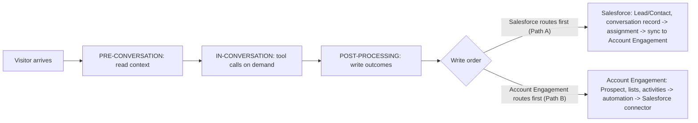

<Note>
  **Audience:** Marketing Operations, Account Engagement (Pardot) administrators, Salesforce administrators, Revenue Operations.
  **Purpose:** How to connect 1mind to Account Engagement through the **1mind External Client App**, how 1mind uses Account Engagement before, during, and after a conversation, and which Prospect fields and conversation-history options 1mind can write.
</Note>

## 1. Introduction

### 1.1 Overview

1mind deploys **Superhumans** that hold real-time voice and chat conversations with website visitors, prospects, and customers. A Superhuman answers product questions, qualifies the buyer against the customer's own criteria, and books the right meeting. Every conversation produces structured output: a summary, a readable transcript, qualification and discovery signals, the meeting outcome, and attribution data.

The Account Engagement (Pardot) integration sends that output to the customer's marketing automation platform and to Salesforce. Depending on where the customer routes leads, 1mind writes approved data to:

- **Salesforce** (Lead, Contact, Task, or a 1mind conversation custom object), through the 1mind Salesforce connector; and/or
- **Account Engagement Prospects** (default and custom Prospect fields, list membership, and optionally External Activities), through the **Account Engagement API v5**.

Account Engagement then does what it already does: scoring and grading, automation rules, Engagement Studio, completion actions, assignment, and synchronization with Salesforce through the Salesforce connector.

**One app per customer.** Every Salesforce customer installs the **1mind External Client App (1mind ECA)**, and the same app authorizes 1mind for Salesforce and for Account Engagement. The customer does not build an OAuth app and never runs two apps for 1mind. Their work is limited to installing the app, approving access as a dedicated integration user, and giving 1mind the Account Engagement Business Unit ID.

### 1.2 What this guide covers

| Part | What it covers | Primary reader |
| --- | --- | --- |
| **2. Technical Setup** | Connection path, integration user, Business Unit ID, 1mind ECA install and approval, Prospect fields, lists, Salesforce history object, connection testing | Account Engagement admin, Salesforce admin, 1mind implementation engineer |
| **3. The 1mind Conversation Lifecycle** | Pre-conversation, in-conversation, and post-processing stages, and where Account Engagement participates in each | Marketing Ops, RevOps |
| **4. Use Cases** | Which use cases read from or write to Account Engagement or Salesforce, and at which stage | Marketing Ops, RevOps, business owners |
| **5. Data Model and Field Options** | Prospect fields, history-layer options (Account Engagement has no custom data objects), limits, and write rules | Account Engagement and Salesforce admins |
| **6–10. Automation, testing, operations** | Automation patterns, acceptance tests, monitoring, go-live checklist, intake | Marketing Ops, 1mind |

This guide does not cover Superhuman persona design, content training, or website deployment. Those are handled in the 1mind onboarding process. 1mind fits into the customer's existing lead-management process instead of creating a parallel one. **The first system 1mind writes to is the system where routing happens today.**

### 1.3 Guiding principle: keep your existing workflow and write order

| Your current lead flow | 1mind's first write | What happens next | 1mind must not |
| --- | --- | --- | --- |
| **Salesforce routes first.** Leads are created in Salesforce (web-to-lead, Lead Assignment Rules, LeanData, Distribution Engine, Flow), then sync to Account Engagement. | **Salesforce** (Lead/Contact, Task, 1mind conversation object) | Salesforce routing assigns the Lead; the Salesforce connector creates or updates the Prospect in Account Engagement; Account Engagement automation runs on the synced data. | Create the Prospect in Account Engagement first, which would bypass Salesforce routing. |
| **Account Engagement routes first.** Prospects are created, scored, graded, and assigned in Account Engagement, and the Salesforce connector then creates or updates the Lead/Contact. | **Account Engagement** (Prospect upsert; list membership or External Activity) | Account Engagement automation scores and assigns the Prospect; the Salesforce connector creates or updates the Lead or Contact with the correct owner, exactly as for a form handler or form fill. | Write the same Lead/Contact directly to Salesforce, which would bypass Account Engagement assignment and create duplicates or sync conflicts. |
| **Hybrid.** Account Engagement owns marketing qualification (MQL); Salesforce owns sales assignment after hand-off. | Account Engagement first | Account Engagement qualifies and triggers assignment; Salesforce routes after hand-off. | Write sales-owned Salesforce fields (owner, status, opportunity) unless the signed design delegates them. |

Because Account Engagement and Salesforce share data through the Salesforce connector, also confirm the **field sync behavior** for every field 1mind writes (*Use Salesforce's value*, *Use Account Engagement's value*, or *Use the most recently updated value*). A field that 1mind writes in Account Engagement but that is set to *Use Salesforce's value* is overwritten at the next sync.

### 1.4 Connection paths and readiness

The write order decides whether 1mind needs the Account Engagement API at all.

| Path | When to use | What the customer does | Status |
| --- | --- | --- | --- |
| **A. Salesforce only, through the 1mind ECA** | Salesforce routes first. Account Engagement receives 1mind data through its existing Salesforce connector sync. | Install the 1mind ECA; approve access as the integration user. | **Production-ready** |
| **B. Salesforce + Account Engagement, through the 1mind ECA** | Account Engagement routes first, or the design needs list membership or External Activities. | Install the 1mind ECA; approve access as an integration user who is also an Account Engagement user; provide the Business Unit ID. | **Production-ready** |

**Choosing a path:** if Salesforce routes first, use **Path A** (no Account Engagement API access is needed; the Salesforce connector carries 1mind fields to the Prospect). If Account Engagement routes first, use **Path B**.

### 1.5 Setup at a glance

| # | Step | Owner | Paths | Output |
| --- | --- | --- | --- | --- |
| 1 | Confirm write order, sync behavior, and connection path | Marketing Ops + RevOps + Salesforce admin + 1mind | All | Signed decision |
| 2 | Create the integration user | Salesforce admin + Account Engagement admin | All | Integration user (Account Engagement user for B) |
| 3 | Record the Business Unit ID | Salesforce admin | B | Business Unit ID |
| 4 | Install and authorize the 1mind ECA | Salesforce admin + integration user | A, B | Authorized 1mind connections |
| 5 | 1mind configures the connections | 1mind | All | Salesforce and Account Engagement connections |
| 6 | Create Prospect custom fields | Account Engagement admin | All | Field API names, sync behavior |
| 7 | Create lists and (optional) External Activity type | Account Engagement admin | B | List IDs, extension and activity type names |
| 8 | Prepare the Salesforce history layer (if used) | Salesforce admin | All | Custom object or Task design |
| 9 | Smoke-test the connections | 1mind + admins | All | Verified read/write |
| 10 | Configure Account Engagement automation | Marketing Ops | All | Automation rules / Engagement Studio live |

## 2. Technical setup

### Prerequisites

- Salesforce **System Administrator**, or a user who can install apps and manage permission sets.
- Account Engagement **Administrator** role.
- **Salesforce User Sync** enabled in Account Engagement (standard for current accounts).
- The signed write-order and connection-path decision (Step 1).
- An approved list of Prospect fields and history-layer fields (Part 5).

<Steps>
  <Step title="Confirm write order, sync behavior, and connection path">
    Answer these with Marketing Ops, RevOps, and the Salesforce administrator: where are new leads created and routed today (Salesforce or Account Engagement)? How does Account Engagement create Salesforce records? For every field 1mind will write, what is the connector sync behavior? May 1mind **create** net-new records, or only **update** existing ones? Which stages use Account Engagement? Where will conversation history live? Which connection path applies (A or B)?

    **Output:** a one-page decision recorded in the customer's 1mind solution blueprint.
  </Step>
  <Step title="Create the integration user">
    In Salesforce **Setup → Users**, create a dedicated user (e.g. `1mind Integration`) with a monitored team mailbox; a *Salesforce Integration* user license is appropriate where available. Assign a permission set granting **API Enabled** and the object access the design needs (Lead, Contact, Task, Campaign Member, and the 1mind conversation object). **Path B:** also make the user an Account Engagement user in the target business unit with permission to create/edit Prospects and use the API. All 1mind writes are attributed to this user.

    <Note>**Scope versus user access.** The `pardot_api` scope belongs to the OAuth app (the 1mind ECA), not to the user. The user needs Account Engagement access in the business unit. Both are required, without the Account Engagement user record, API calls are rejected even when Salesforce access works.</Note>
  </Step>
  <Step title="Record the Business Unit ID (Path B)">
    In Salesforce **Setup**, search for **Account Engagement → Business Unit Setup**. Copy the 18-character ID that starts with `0Uv` (different from the numeric Pardot account ID). Record staging and production IDs if separate, and share with 1mind. Every Account Engagement API call sends this ID in the `Pardot-Business-Unit-Id` header.
  </Step>
  <Step title="Install and authorize the 1mind ECA (Paths A and B)">
    Install the **1mind External Client App** using the install link from your 1mind implementation engineer (production and sandbox orgs are installed separately). In **Setup → External Client App Manager → 1mind**, set the policies:

    | Policy | Value |
    | --- | --- |
    | **Permitted Users** | Admin-approved users are pre-authorized |
    | **Access** | Assign the integration user's permission set or profile |
    | **IP Relaxation** | Per your security policy (1mind provides egress IPs on request) |
    | **Refresh Token Policy** | Valid until revoked, or per your policy |

    1mind sends an **Authorize** link from the 1mind console. The integration user opens it, signs in to Salesforce, and approves access, once for each 1mind connection the design uses (Salesforce, and Account Engagement for Path B). Salesforce returns the org's address with the approval, so the customer does not provide a My Domain URL or any app credentials.

    **Re-authorization** is required if the integration user is deactivated, the refresh token is revoked, or 1mind adds a scope to the ECA (for example, moving from Path A to Path B).
  </Step>
  <Step title="1mind configures the connections">
    1mind creates the connections below (listed so Ops can review and audit them):

    | Connection | Path | Credential | Requests go to |
    | --- | --- | --- | --- |
    | **Salesforce** | A, B | 1mind ECA, authorization code | The org's Salesforce instance |
    | **Account Engagement** | B | 1mind ECA, authorization code, with `pardot_api` scope | `https://pi.pardot.com` (`https://pi.demo.pardot.com` for developer/demo orgs), with the `Pardot-Business-Unit-Id` header |
  </Step>
  <Step title="Create Prospect custom fields">
    In **Account Engagement Settings → Object and Field Configuration → Prospect Fields → Custom Fields → + Add Custom Field**. For each approved 1mind field (section 5.3), set the **Field Name**, record the generated **API Field Name** exactly (typically ending in `__c`), the **Type**, the **Salesforce Field Name** mapping, and the **Sync Behavior** per the Step 1 decision. For dropdown fields, record the exact allowed values, 1mind writes the value, not the label.
  </Step>
  <Step title="Create lists and (optional) External Activity type (Path B)">
    Create static **Lists** (e.g. `1mind – Qualified Conversation`, `1mind – Nurture`, `1mind – Partner/Support`) and record each **List ID**. Optionally add an **External Activity** type under **Setup → Marketing App Extensions → New** (name `1mind`, activity type e.g. `AI Conversation`) to record each conversation as an engagement event. Record the extension and activity type names exactly.
  </Step>
  <Step title="Prepare the Salesforce history layer (if used)">
    Account Engagement has no custom data objects. For a per-conversation record with summary, transcript, and discovery detail, create a Salesforce custom object `1mind Conversation` (`AI_Conversation__c`) related to the Lead and Contact (section 5.5). Mark **1mind Conversation ID** as **External ID** and **Unique**. Grant the integration user access and add it to page layouts. This works on every path because it uses the Salesforce connection.
  </Step>
  <Step title="Smoke-test the connections">
    Run in a sandbox or demo business unit first, then production: authorize the ECA; update a 1mind field on a test Lead/Contact and confirm it syncs to the Prospect; (Path B) list the custom fields via the API, upsert a test Prospect, add it to a list, and post an External Activity; write the history record twice with the same conversation ID and confirm one record; run a full test conversation.
  </Step>
  <Step title="Configure Account Engagement automation">
    Configure the customer-owned automation that reacts to 1mind data (Part 6), after the connections are verified so automation is tested against real 1mind records.
  </Step>
</Steps>

## 3. The 1mind conversation lifecycle and where Account Engagement is used

Every 1mind deployment runs up to three kinds of workflows around a conversation; each can read from or write to connected systems.



### 3.1 Pre-conversation

**When it runs:** when the session starts, before the Superhuman speaks (for scheduled meetings, a pre-call workflow runs before the meeting). **What it does:** gathers context so the Superhuman does not ask what the business already knows, URL parameters (UTM, campaign, a known email from an Account Engagement email link), the visitor token, and Salesforce or Account Engagement data. **Typical setup:** read context from **Salesforce** (Lead, Contact, Account, Opportunity, owner). Read the Prospect directly (Path B) only when it holds data Salesforce does not, such as score, grade, or engagement history.

### 3.2 In-conversation (tool calls)

| Tool call | System | When to use |
| --- | --- | --- |
| Returning-visitor lookup | Salesforce (default) or Account Engagement Prospect | Visitor was anonymous at session start and gives an email mid-conversation |
| Meeting routing and booking link | Salesforce owner and the booking tool | Inbound qualification and meeting booking |
| Opt-out / preference check | Account Engagement Prospect (Path B) | Before offering to email content |

### 3.3 Post-processing

**When it runs:** after the conversation ends and 1mind has generated the summary, transcript, and extracted fields. **What it does:** writes the outcome in the order set by the write-order decision (section 1.3).

**Salesforce-first sequence (Path A):** guard (stop if no conversation ID); find Lead/Contact by email (Contact first, then Lead); upsert the record with approved 1mind fields (Salesforce assignment rules route new Leads); upsert `AI_Conversation__c` by conversation ID (or create a Task); optionally add a Campaign Member; verify and record Salesforce IDs. Prospect values arrive through the connector sync.

**Account Engagement-first sequence (Path B):** guard (stop if no conversation ID or no email); normalize values to Account Engagement formats and truncate to limits; `POST /api/v5/objects/prospects/do/upsertLatestByEmail` with default and custom fields (create only if approved); add to the matching 1mind list; optionally post one External Activity; optionally write the Salesforce history record after the connector has created the Lead/Contact; verify and record IDs. Account Engagement automation then scores, grades, and assigns; the Salesforce connector creates or updates the Lead/Contact.

## 4. Use cases and where Account Engagement is used

| Use case | Pre-conversation (read) | In-conversation (tool call) | Post-processing (write) | Automation afterwards |
| --- | --- | --- | --- | --- |
| **Website product expert** | Salesforce record by email if known | Optional returning-visitor lookup | Lead/Contact or Prospect with summary, topics, product interest; history record | Score product interest; Engagement Studio product track |
| **Inbound qualification and meeting booking** | Salesforce owner and routing context | Booking link (Salesforce owner / booking tool) | Qualification and meeting fields; list `1mind – Qualified` (Path B); history record with discovery detail | Salesforce assignment (Path A) or automation rule assigns and syncs (Path B) |
| **Email or campaign follow-up** | Prospect or Lead by the email in the email link; UTM/campaign | Optional opt-out check | Intent and next step; External Activity (Path B) | Engagement Studio branch on field or activity; alert assigned user |
| **Event or webinar follow-up** | Lead/Contact and event context |, | Qualification fields; External Activity (Path B); history record | Post-event program; high-intent alert |
| **Re-engagement of cold leads** | Prior 1mind fields, score, grade | Optional returning-visitor lookup | Re-engagement reason and objections | Re-score; notify assigned user |
| **Partner, support, or careers deflection** |, |, | Status `Partner`/`Support`; partner list (Path B) | Route to partner/support process; no sales assignment |

## 5. Data model and field options

### 5.1 Where each kind of data belongs

| Record | Holds | Lifecycle | Use for |
| --- | --- | --- | --- |
| **Prospect default fields** | Identity and firmographics | Updated per write rules | Matching, assignment, personalization |
| **Prospect 1mind custom fields** | **Latest** 1mind state | Overwritten each conversation | Automation rules, Engagement Studio, scoring, Salesforce sync |
| **List membership** (Path B) | Outcome bucket | Added per conversation | Clean automation triggers |
| **External Activity** (optional; Path B) | One engagement event per conversation | Write-once | Engagement history, Engagement Studio, scoring |
| **Salesforce `AI_Conversation__c`** (recommended history layer) | **One record per conversation** with full detail | Upserted by conversation ID | Reporting, sales view, follow-up content |
| **External transcript (1mind)** | Full transcript and recording | Governed by retention policy | Audit; link stored on the history record |

### 5.2 Prospect, default fields

| Account Engagement field | API v5 name | 1mind source | Default write rule |
| --- | --- | --- | --- |
| Email | `email` | Captured email, else email passed in the URL | **Match key.** Never overwritten. |
| First Name | `firstName` | Captured first name | Write if empty (or overwrite, if approved) |
| Last Name | `lastName` | Captured last name | Write if empty (or overwrite, if approved) |
| Company | `company` | Captured company | Write if empty |
| Job Title | `jobTitle` | Captured role | Write if empty |
| Phone | `phone` | Captured phone | Write if empty |
| Country | `country` | Captured country, normalized | Write if empty |
| State | `state` | Captured state, normalized | Write if empty |
| City | `city` | Captured city | Optional |
| Website | `website` | Company domain | Optional |
| Industry | `industry` | Captured industry | Optional |
| Employees | `employees` | Captured company size | Optional |
| Source | `source` | `1mind` (first touch only) | Write if empty |
| Score / Grade | `score` / `grade` |, | **Read only.** Owned by Account Engagement scoring and grading. |
| Assigned User | `assignedToUser` |, | **Read only.** Owned by assignment automation. |

On Path A, 1mind writes the matching Salesforce Lead/Contact fields and the connector carries them to the Prospect.

### 5.3 Prospect, 1mind custom fields (options)

Create only the fields your automation will use. Map each to a Salesforce Lead/Contact field when the value must reach Sales (always, on Path A).

| Suggested field name | Suggested API name | Type | 1mind source | Purpose |
| --- | --- | --- | --- | --- |
| 1mind Last Conversation ID | `oneMind_Last_Conversation_ID__c` | Text | Conversation ID | Correlation with 1mind and the history record |
| 1mind Last Conversation Date | `oneMind_Last_Conversation_Date__c` | Date | Conversation date | Recency |
| 1mind Qualification Status | `oneMind_Qualification_Status__c` | Dropdown | Outcome (`Qualified`, `Nurture`, `Disqualified`, `Partner`, `Support`, `No Outcome`) | Automation and assignment trigger |
| 1mind Primary Intent | `oneMind_Primary_Intent__c` | Text | Extracted intent | Segmentation |
| 1mind Urgency | `oneMind_Urgency__c` | Dropdown | Extracted urgency | Prioritization |
| 1mind Product Interest | `oneMind_Product_Interest__c` | Text | Extracted products | Engagement Studio track |
| 1mind Next Best Action | `oneMind_Next_Best_Action__c` | Text Area | Recommended follow-up | Sales follow-up |
| 1mind Meeting Booked | `oneMind_Meeting_Booked__c` | Checkbox | Booking outcome | Suppress nurture; alert |
| 1mind Meeting Date | `oneMind_Meeting_Date__c` | Date | Booked meeting start | Reporting |
| 1mind Last Summary | `oneMind_Last_Summary__c` | Text Area | Summary | Sales and personalization |
| 1mind Conversation URL | `oneMind_Conversation_URL__c` | Text | Link to the conversation in 1mind | Full transcript access |
| 1mind Source URL | `oneMind_Source_URL__c` | Text | Page where the conversation started | Attribution |
| 1mind Times Engaged | `oneMind_Times_Engaged__c` | Number | Conversation count | Engagement scoring |

### 5.4 Conversation history options

Account Engagement has no custom data objects, so conversation history lives in one of these:

| Option | Holds | Pros | Considerations | Recommended when |
| --- | --- | --- | --- | --- |
| **A. Salesforce custom object `AI_Conversation__c`** | Full per-conversation detail | Unlimited history; reportable; visible to Sales; upsert by External ID prevents duplicates; works on every path | Account Engagement automation sees it only with Custom Object sync | **Default** |
| **B. Salesforce Task** | Summary and outcome as an activity | No new object; appears in the activity timeline | Limited structured fields; long text truncated in some views | Lightweight history |
| **C. Account Engagement External Activity** | One event per conversation (type + value) | Native trigger in Engagement Studio, automation rules, scoring | Path B only; value is a short string; edition-dependent | Engagement and nurture triggers |
| **D. Prospect fields only** | Latest state | Simplest | History is overwritten | Pilots |

A common design is **A + C**: the Salesforce object holds the detail; the External Activity drives Account Engagement automation.

### 5.5 Salesforce `AI_Conversation__c`, core fields

| Field | API name | Type | Source |
| --- | --- | --- | --- |
| 1mind Conversation ID | `Conversation_ID__c` | Text(100), **External ID, Unique** | Session ID (upsert key) |
| Lead | `Lead__c` | Lookup(Lead) | Matched Lead |
| Contact | `Contact__c` | Lookup(Contact) | Matched Contact |
| Email | `Email__c` | Email | Captured email |
| Conversation Date | `Conversation_Date__c` | Date/Time | Conversation start |
| Status | `Status__c` | Picklist | Outcome |
| Summary | `Summary__c` | Long Text Area(32,768) | Summary |
| Transcript | `Transcript__c` | Long Text Area(131,072) | Readable transcript (truncated to limit) |
| Conversation URL | `Conversation_URL__c` | URL | Link to the full conversation in 1mind |
| Source URL | `Source_URL__c` | URL | Starting page |
| Duration (seconds) | `Duration_Seconds__c` | Number | Duration |
| Environment | `Environment__c` | Text(50) | Test or production |

**Optional groups:** qualification and discovery (pain points, current solution, tech stack, integrations, products, use cases, budget, contract end, persona match); MEDDPICC; objections and risk; meeting and hand-off (meeting date, demo/POC/trial requested, booked host); sales follow-up content (recommended opening, key quotes, critical context, follow-up email body).

### 5.6 Field rules

| Rule | Detail |
| --- | --- |
| Text limit | 255 characters for Account Engagement Text fields. 1mind truncates. |
| Text Area | Confirm the limit in your account; keep summaries concise and store the full transcript on the history record or in 1mind. |
| Dropdowns | 1mind writes the exact value. Provide the allowed values. |
| Checkbox | `true` / `false`. |
| Request body | Account Engagement v5 rejects unknown fields. 1mind sends only approved field API names. |
| Empty values | Omitted. 1mind never blanks an existing value. |
| Idempotency | Prospect keyed by email; history record keyed by conversation ID; External Activity posted once per conversation ID. |
| Read-only | Score, grade, assigned user, and Salesforce-owned fields are not written. |

## 6. Account Engagement automation after 1mind writes

1mind writes data; Account Engagement and Salesforce own what happens next.

| Pattern | Configuration | Trigger |
| --- | --- | --- |
| **Qualified conversation → assignment** | Automation rule matching `oneMind_Qualification_Status__c = Qualified` or list membership; adjust score, add to Salesforce campaign, assign via Salesforce active assignment rule | Prospect field or list |
| **Nurture** | Engagement Studio program with a rule on `oneMind_Product_Interest__c` or the External Activity | Field or activity |
| **Suppress nurture after booking** | Suppression list or rule on `oneMind_Meeting_Booked__c = true` | Field |
| **Scoring** | Scoring/automation rule adjusting score for an External Activity or qualified status | Activity or field |
| **Partner / support routing** | Automation rule on status `Partner` / `Support`; notify the right team; exclude from MQL | Field or list |
| **Sales alert** | Notify assigned user; Salesforce Task via completion action | Field or list |

Keep one path to Salesforce; extend existing automation rather than building a separate 1mind-only routing path; and confirm sync behavior for every 1mind field so the connector does not overwrite it.

## 7. Testing and acceptance

| # | Scenario | Expected result |
| --- | --- | --- |
| 1 | Known record, qualified, meeting booked | Record updated; qualified list or assignment fires; Lead/Contact and Prospect in sync; history record created |
| 2 | Net-new email (creation approved) | Lead or Prospect created; assignment and sync per automation |
| 3 | Net-new email (creation not approved) | No Lead or Prospect created; history handled per design |
| 4 | No email captured | No person write; history record per design |
| 5 | Same conversation re-processed | No duplicate list action, activity, or history record |
| 6 | Long summary and URL | Truncated; write succeeds |
| 7 | Dropdown value outside the allowed list | Normalized or omitted; no API error |
| 8 | Partner conversation | Partner status or list; no sales assignment |
| 9 | Field sync behavior | 1mind value is not unexpectedly overwritten by the connector |
| 10 | Refresh token revoked or integration user deactivated | Write fails and alerts; succeeds after re-authorization |
| 11 | Wrong Business Unit ID (Path B) | Error surfaced; no write to another business unit |

**Acceptance:** all scenarios pass, no duplicate Leads/Prospects/history records, automation fires as designed, and Marketing Ops signs off.

## Appendix A, Account Engagement API v5 reference used by 1mind

All Account Engagement calls include:

```text
Authorization: Bearer {access_token}
Pardot-Business-Unit-Id: {businessUnitId}
```

**Read Prospect by email**

```text
GET https://pi.pardot.com/api/v5/objects/prospects?fields=id,email,firstName,lastName,company,score,grade,oneMind_Qualification_Status__c&email=jane@example.com
```

**Upsert Prospect by email**

```json
POST https://pi.pardot.com/api/v5/objects/prospects/do/upsertLatestByEmail
{
  "matchEmail": "jane@example.com",
  "prospect": {
    "email": "jane@example.com",
    "firstName": "Jane",
    "lastName": "Doe",
    "company": "Acme Corp",
    "jobTitle": "VP Operations",
    "oneMind_Qualification_Status__c": "Qualified",
    "oneMind_Meeting_Booked__c": true,
    "oneMind_Last_Summary__c": "Jane asked about..."
  },
  "fields": ["id", "email", "oneMind_Qualification_Status__c"]
}
```

**Add to list**

```json
POST https://pi.pardot.com/api/v5/objects/list-memberships
{ "listId": 12345, "prospectId": 67890 }
```

**External Activity**

```json
POST https://pi.pardot.com/api/v5/external-activities
{ "extension": "1mind", "type": "AI Conversation", "value": "Qualified", "email": "jane@example.com" }
```

Field API names above are illustrative. Use the names recorded during setup.
