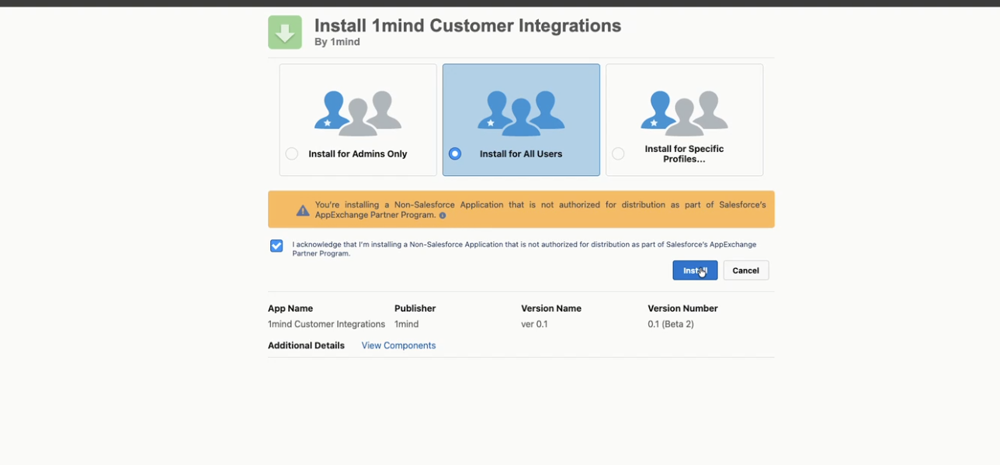
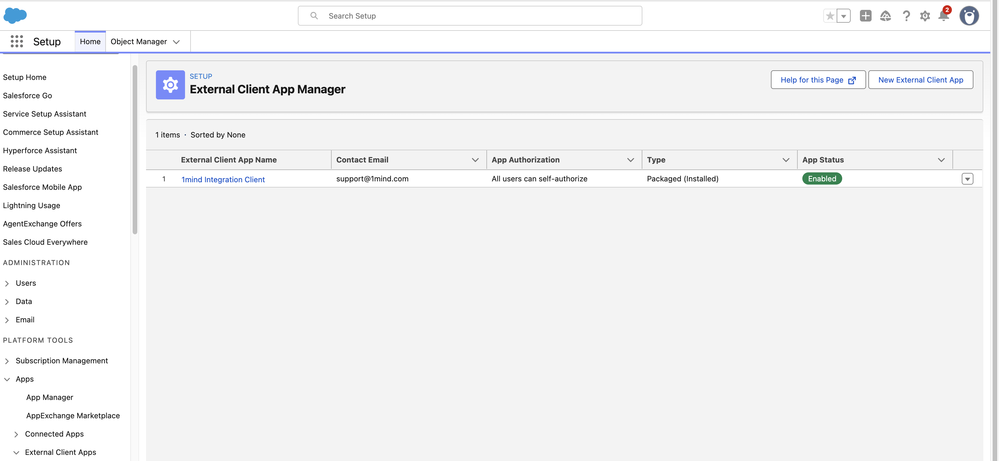
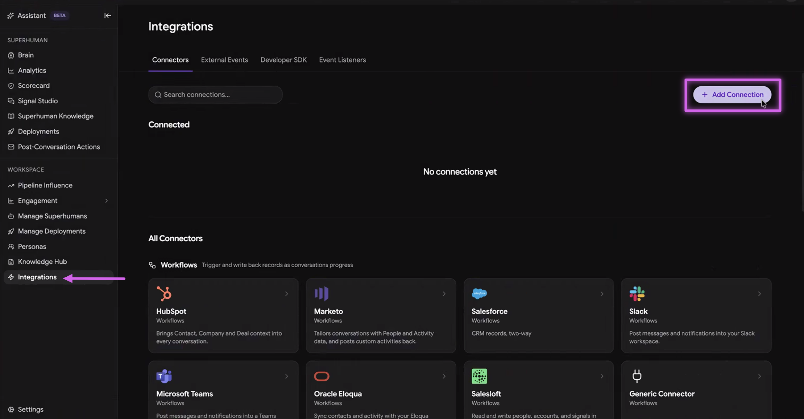
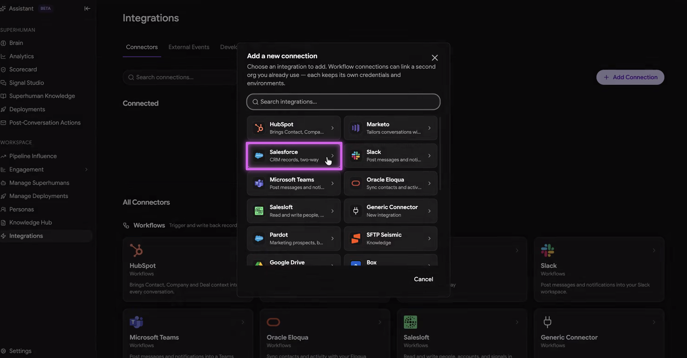
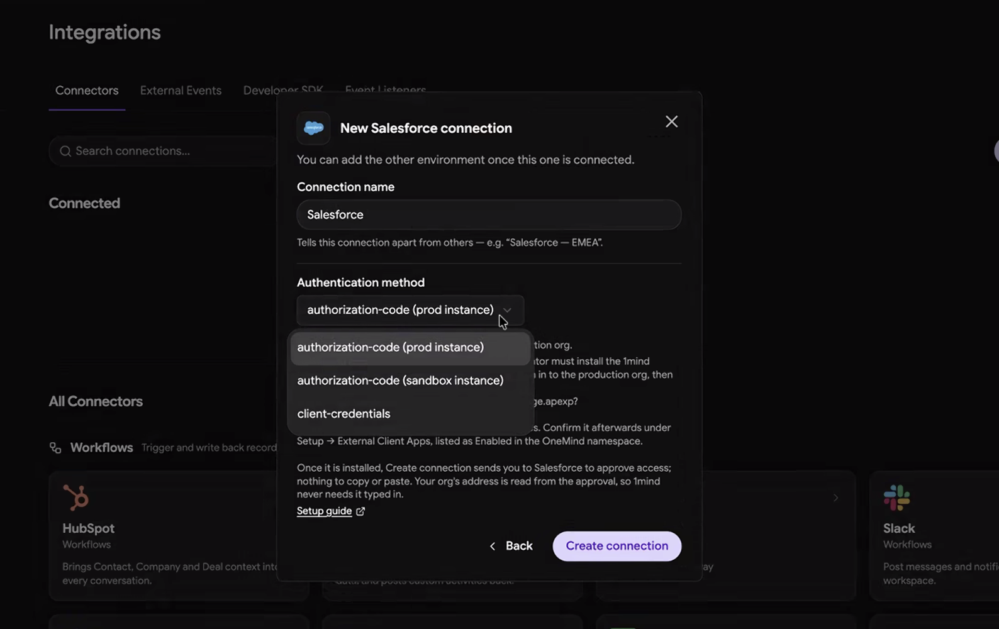
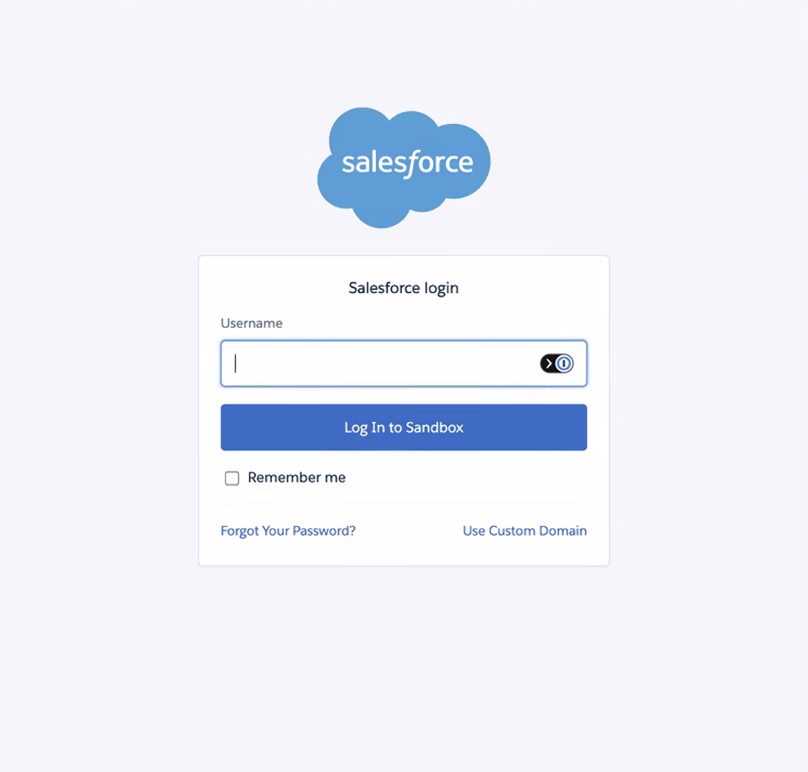
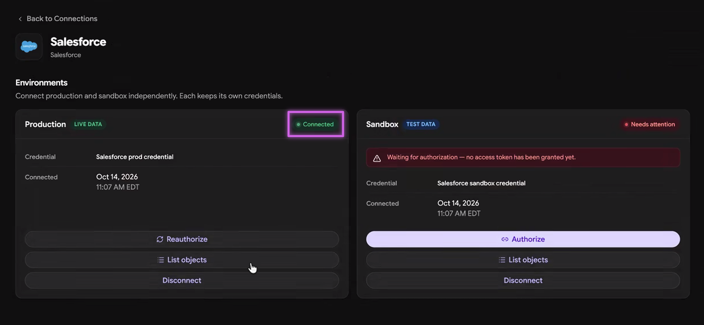

This guide walks a Salesforce admin through installing the **1mind Integration Client** managed package, authorizing OAuth access, and connecting 1mind to your Salesforce org from the **Integrations** tab in the 1mind Console.

**Who should perform this install:** a Salesforce user with the **System Administrator** profile (or equivalent permissions to install managed packages).

<Note>**Best practice:** Use a service account that isn't tied to a specific person, in case they leave or lose access.</Note>

**Time required:** about 10 minutes.

## Prerequisites

- A Salesforce edition that supports managed package installs (Enterprise, Performance, Unlimited, Developer).
- System Administrator access to the Salesforce org where 1mind should connect.
- From your 1mind account manager: the package install URL (Step 1), access to the 1mind Console (Step 2), and confirmation of which Salesforce org (production or sandbox) to install into.

## Step 1: Install the package

<Steps>
  <Step title="Sign in to the target Salesforce org">
    Sign in to the target org in your browser: production at [https://login.salesforce.com](https://login.salesforce.com) or your sandbox at [https://test.salesforce.com](https://test.salesforce.com).
  </Step>
  <Step title="Open the install URL in the same browser">
    - **Production:** `https://login.salesforce.com/packaging/installPackage.apexp?p0=04tcx000002Y2hNAAS`
    - **Sandbox:** `https://test.salesforce.com/packaging/installPackage.apexp?p0=04tcx000002Y2hNAAS`
  </Step>
  <Step title="Review the package details">
    - **Publisher:** 1mind
    - **Package name:** 1mind Integration Client
    - **Namespace:** OneMind
  </Step>
  <Step title="Install for all users">
    Under **Install for**, select **Install for All Users**, then click **Install**.

    <Frame>
      
    </Frame>
  </Step>
  <Step title="Wait for confirmation">
    Wait for the confirmation screen (about 1 to 2 minutes). You'll see **Installation Complete** when done.

    <Frame>
      
    </Frame>
  </Step>
</Steps>

## Step 2: Connect Salesforce from the 1mind Console

Your 1mind Customer Success Manager provides access to the 1mind Console and can walk you through authenticating into Salesforce.

<Steps>
  <Step title="Add a connection">
    In the 1mind Console, go to **Workspace → Integrations** and click **+ Add Connection**.

    <Frame>
      
    </Frame>
  </Step>
  <Step title="Select Salesforce">
    Choose **Salesforce** from the list of connections.

    <Frame>
      
    </Frame>
  </Step>
  <Step title="Choose the instance and create the connection">
    Select which instance to connect to first (Production or Sandbox) and click **Create Connection**.

    <Frame>
      
    </Frame>
  </Step>
  <Step title="Authenticate with your Integration User">
    You are redirected to Salesforce. Authenticate with an **Integration User**.

    <Frame>
      
    </Frame>
  </Step>
  <Step title="Confirm the connection">
    After you authenticate into Sandbox or Production, return to the Console (**Integrations** section) and confirm the authenticated instance shows **Connected** at the top right of the tile.

    <Frame>
      
    </Frame>
  </Step>
</Steps>

<Note>To connect the second environment: in the Console, go to **Workspace → Integrations**, select the Salesforce connection, and click **Authorize** on the other tile (for example, Production after Sandbox).</Note>

## Verifying the installation

In your Salesforce org:

1. **Setup → Installed Packages**: confirm **1mind Integration Client** is listed.
2. **Setup → External Client Apps**: confirm **1mind Integration Client** appears under the `OneMind` namespace and is **Enabled**.

Your 1mind contact can confirm on their end that API calls into your org are succeeding.

## Uninstalling

To remove the integration:

1. Ask your 1mind contact to revoke access from 1mind's side.
2. In Salesforce: **Setup → Installed Packages**, next to **1mind Integration Client**, click **Uninstall**.
3. Follow the uninstall prompts. Salesforce removes the External Client App and all package components.

## Troubleshooting

<AccordionGroup>
  <Accordion title='"This app isn't installed in your org" during the OAuth flow'>
    The package didn't install fully, or OAuth replication is still propagating. Wait 5 minutes and retry. If it persists, uninstall and reinstall.
  </Accordion>
  <Accordion title='"redirect_uri_mismatch" during the OAuth flow'>
    Contact 1mind support with the full error URL. This usually means 1mind needs to update the callback URL registration on their side.
  </Accordion>
  <Accordion title="OAuth login succeeds but 1mind can't access data">
    Rare, but it may indicate restrictive OAuth policies on your org or service-user permissions. Contact 1mind and work with support to resolve the issue.
  </Accordion>
  <Accordion title="OAuth link not working">
    Confirm the link matches the correct environment (sandbox vs production). If the issue persists, contact your 1mind account manager to regenerate the link.
  </Accordion>
  <Accordion title="Wrong Salesforce org connected">
    Log out of the incorrect org, log into the correct one, and reconnect.
  </Accordion>
  <Accordion title="Success message doesn't appear after OAuth">
    Check for browser pop-up blockers, try a different browser, or contact your 1mind account manager to regenerate the OAuth link.
  </Accordion>
</AccordionGroup>

## Support

For help with installation or authorization:

- **Email:** [support@1mind.com](mailto:support@1mind.com)
- **1mind account manager:** use your existing channel
