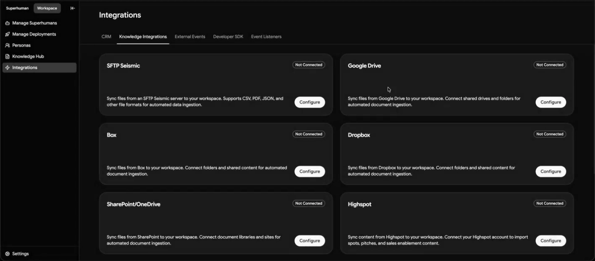
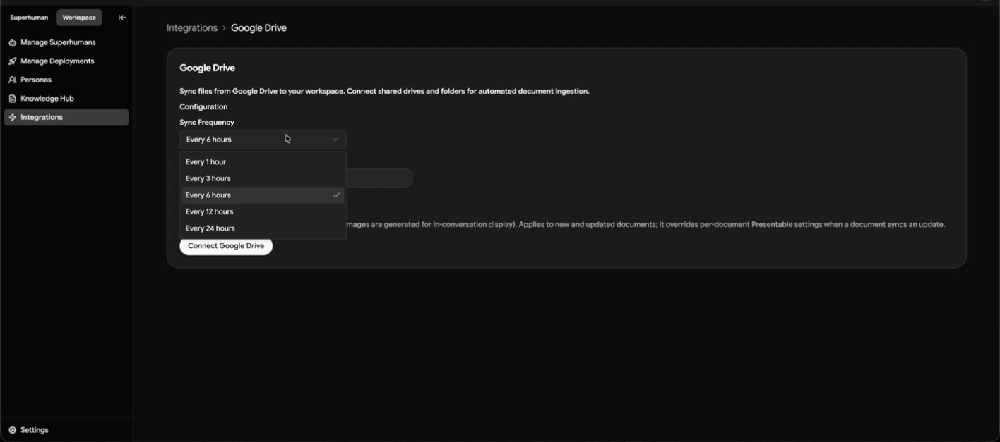
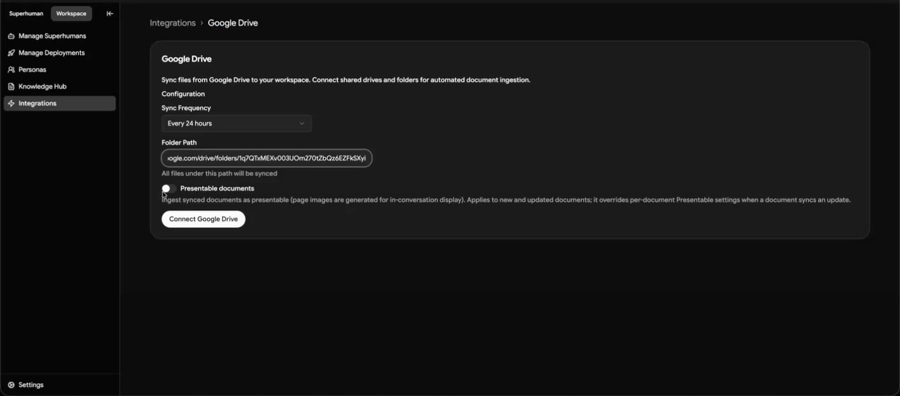
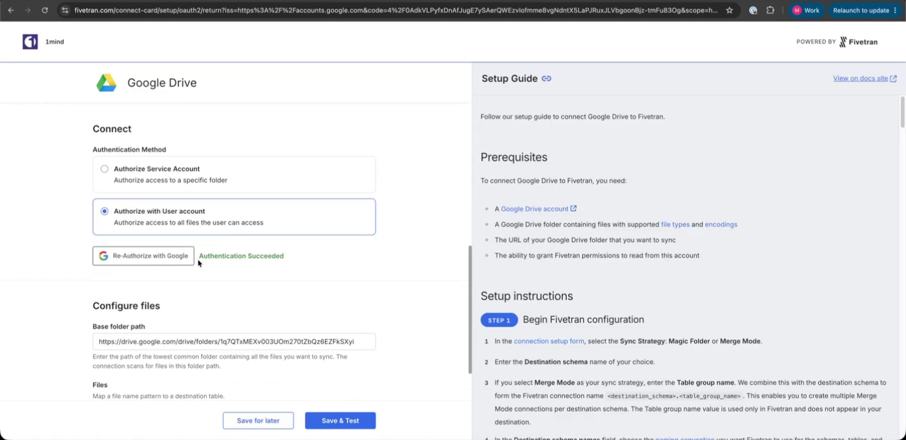
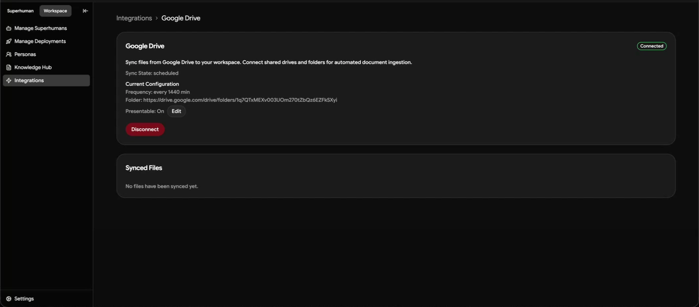
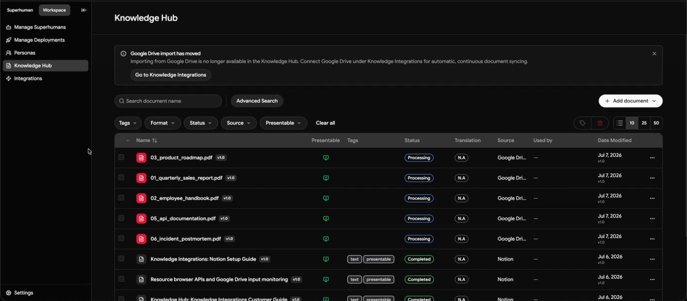
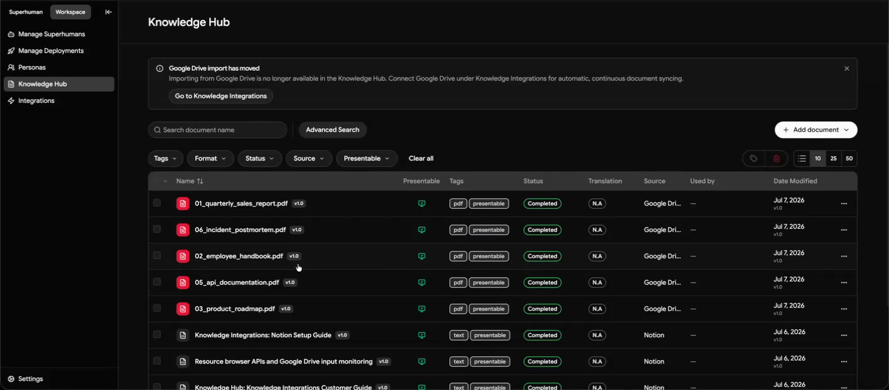

<Note>
**This page is in review and not yet approved (DOCS-26).** It carries drafted changes and is not final. Remove this banner before publishing.
</Note>

The Google Drive integration syncs files from a Drive folder you choose, including everything in its subfolders, directly into the 1mind Knowledge Hub. Once connected, the files under that folder sync into the Hub on the schedule you set, and images in your documents can be processed so they show in conversation. When a file changes in Drive, the Hub picks it up on the next sync, so you no longer have to export or re-upload knowledge content by hand.

This guide walks through connecting Google Drive step by step. The whole setup takes a few minutes; after that, the sync runs on its own.

## What you'll need

Before you start, have this ready:

- **The Workspace Admin or Super Admin role in 1mind.** Knowledge integrations are managed at the workspace level, so those are the only two roles that can connect, edit, or remove a source. If you do not see the Integrations page, check your role assignment first.
- **Access to the Google account** that can reach the files you want to sync, you'll sign in to Google during setup and authorize the connection with your own account.
- **The Drive folder URL** you want to sync, copy the link to the folder that holds the content you want in the Hub. Everything under that folder, including subfolders, will be synced.

<Note>You authorize the connection through Google's own secure sign-in window. 1mind never sees or stores your Google password, you grant access directly with Google.</Note>

## Step-by-step setup

<Steps>
  <Step title="Open the Google Drive integration in the Console">

    In the 1mind Console, go to **Integrations → Knowledge Integrations** and click **Configure** on the **Google Drive** card.

    <Frame>
      
    </Frame>

  </Step>
  <Step title="Set the sync frequency">

    Under **Sync Frequency**, choose how often the Hub checks Drive for changes, the options are every 1, 3, 6, 12, or 24 hours. For most teams, **every 24 hours** is the right choice; use the least frequent option that fits how often your content actually changes.

    <Frame>
      
    </Frame>

  </Step>
  <Step title="Enter the folder path">

    In **Folder Path**, paste the link to the Google Drive folder you want to sync. All files under this path will be synced.

    <Tip>The connector pulls in the folder you select **and any subfolders inside it**. Because you can configure only one folder, put everything you want in the Hub inside a single parent folder, organized into subfolders as needed.</Tip>

    <Frame>
      
    </Frame>

  </Step>
  <Step title="Make your documents presentable(optional), then connect">

    If you want content in your documents to be processed and shown in conversation, turn on the **Presentable documents** toggle, this generates page images for in-conversation display. Then click **Connect Google Drive**.

    <Frame>
      
    </Frame>

  </Step>
  <Step title="Authorize with Google">

    Clicking **Connect Google Drive** opens a secure connection window where most settings are already pre-configured. Choose **Authorize with User account**, click **Authorize with Google**, sign in, and grant the requested permissions. When you're done, you'll see **Authentication Succeeded**. Your folder path is already filled in, so click **Save & Test**.

    <Frame>
      
    </Frame>

  </Step>
  <Step title="Confirm the connection in the Console">

    The connection runs a set of checks, then returns you to the Console. The Google Drive card shows a **Connected** status, along with the current configuration, **Sync State**, sync **Frequency**, the **Folder** path, and whether **Presentable** is on. A **Synced Files** section appears below; it will be empty until the first sync brings content in.

    <Frame>
      
    </Frame>

  </Step>
  <Step title="Wait for the first sync">

    The first batch of data can take **up to an hour or more** to appear, depending on how much content is under your folder. Your files will move through a **Processing** state as the Hub ingests them; give them time to finish processing.

    <Frame>
      
    </Frame>

  </Step>
  <Step title="Verify your files in the Knowledge Hub">

    Once the sync runs, open the **Knowledge Hub**. Your Drive files appear with **Source: Google Drive**, and move from **Processing** to **Completed** as they finish. Confirm the files you expected, from the parent folder and its subfolders, all came through. If you enabled **Presentable documents**, documents also carry the **presentable** tag.

    <Frame>
      
    </Frame>

  </Step>
</Steps>
## Remove synced content

You can remove Drive content from 1mind yourself in the Knowledge Hub. You do not need to open a support request, and removing content in 1mind never changes your files in Google Drive. The integration has read access only.

Choose the option that matches what you want:

- **Remove specific documents, keep your Drive files.** Delete the documents in the Knowledge Hub. Your Drive files are untouched. A document you delete in the Hub stays deleted even if the source file is edited later, and a later sync of the same connection does not bring it back.
- **Stop syncing new changes, keep what is already in.** Disconnect the Google Drive source. Disconnecting stops future syncs and leaves the documents already ingested in place.
- **Remove a document everywhere by removing the original.** Deleting the file in Google Drive removes it from 1mind on the next sync. This is the only option that also loses your original, so use it last.

To remove this source from one Superhuman without deleting it from the workspace, disable it for that Superhuman instead. See [Superhuman Knowledge](/configuring/knowledge/superhuman-knowledge) and the destructive actions in the [Knowledge overview](/configuring/knowledge/overview).

{/* TODO (DOCS-26, blocked on Product): (1) confirm the same removal behavior for Notion, Confluence and Salesforce. Priyank confirmed it for the file connectors (Drive, SharePoint, Box, Dropbox) only on 2026-11-10. (2) Owed: what happens at the next sync to a document disabled for a Superhuman while the connector stays connected (Devon's open question). (3) Part 2a: the "one connector per type / only one folder" wording on this page and in the overview/FAQ conflicts with "each folder its own connection" (CASE-417, Priyank) and needs Product's ruling before correcting. (4) Part 2b: whether the sandbox-draft behavior described in the overview/FAQ matches the Knowledge Hub workspace-source model, unverified. */}

## Troubleshooting

| What you're seeing | What to check |
| --- | --- |
| The connection tests don't pass | Reopen the connection window and complete authorization again, choosing **Authorize with User account** and finishing the Google sign-in. If it keeps failing, disconnect and reconnect. |
| No data has appeared yet | Give it time, the first sync isn't instant, and data can take an hour or more to land depending on volume. Confirm the connection shows a **Connected** status and that the folder path points at the right folder. |
| Files are stuck on Processing | Processing runs after files sync in; larger or image-heavy files take longer. Wait for it to finish, then refresh the Knowledge Hub. |
| Some files from the folder are missing | Confirm they sit under the folder path you configured (or one of its subfolders). Anything outside that parent folder won't be synced. |
| Images aren't showing in conversation | Make sure **Presentable documents** was turned on before connecting. If it was added later, let a fresh sync run so new and updated files are processed with images. |
| A large file never synced | Very large files can be slow to sync or may not import from cloud drives. Re-save as a PDF or split into smaller files, and flag persistent issues to your 1mind contact. |

## FAQ

**What does the Google Drive integration sync?**

Files under the Drive folder you specify, including everything in its subfolders. Images inside documents come across too when **Presentable documents** is on.

**How do I choose what gets synced?**

You provide one folder path, and the Hub syncs everything under it. Because you can configure only one folder, structure the content you want ingested inside a single parent folder.

**Is content presentable?**

Yes, turn on **Presentable documents** before connecting. It generates page images so document visuals can be shown in conversation.

**How long until my data shows up?**

The first sync can take up to an hour or more depending on how much content is under your folder. After that, the Hub checks Drive on the frequency you set.

**Where do the credentials come from, and are they safe?**

There are no credentials to copy for Google Drive. You authorize through Google's own secure sign-in window with your own account. 1mind never sees or stores your Google password.

## Need help?

If you run into anything during setup, reach out to your 1mind contact or Customer Success team. They can confirm your configuration and help if any part of the connection needs attention.
