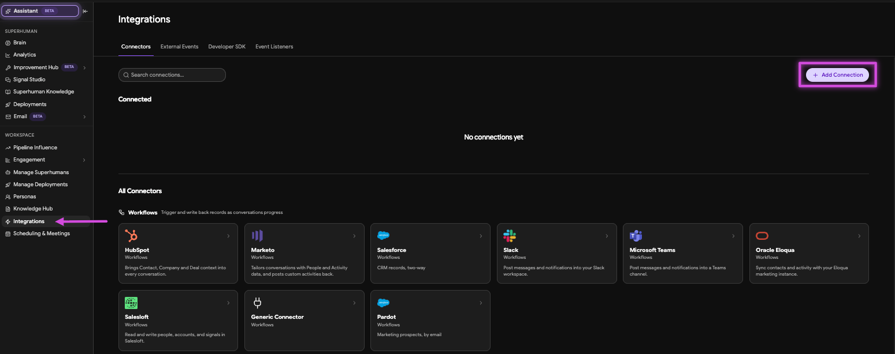
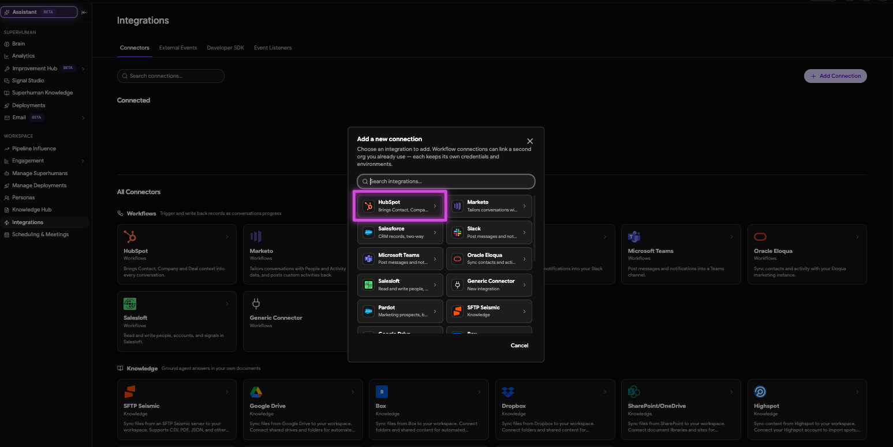
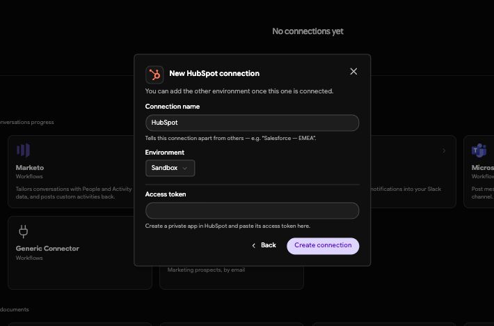
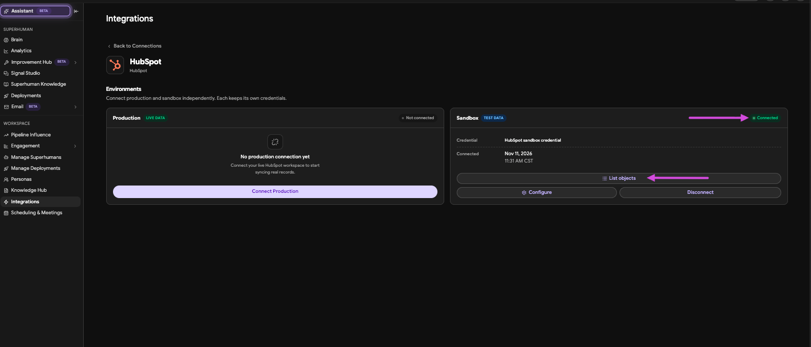

This guide walks you through connecting HubSpot to 1mind. The same connection is used by the Inbound Website SDR and Ride-Along Superhumans. For what each integration reads and writes, see:

- [HubSpot: Inbound Website SDR](/path-to-inbound-hubspot-guide)
- [HubSpot: Ride-Along](/path-to-ride-along-hubspot-guide)

1mind connects to HubSpot with a **Service Key** or a **private app access token**. You create one in each HubSpot account, then paste it into the 1mind Console. Sandbox and production are connected separately, and each keeps its own credentials.

## Before you begin

Make sure you have:

- **Access to the 1mind Console.** Your 1mind Customer Success Manager provides access.
- **A HubSpot user who can create keys.** Creating a Service Key requires a **Super Admin** or a user with **Developer Tools** access. Private apps can only be created by Super Admins.
- **Your HubSpot sandbox and production accounts.** We recommend connecting your sandbox first, testing, then connecting production.
- **The required HubSpot properties and custom objects created**, as agreed with 1mind Services in your field mapping.

<Note>
  Custom objects require a **HubSpot Enterprise** subscription. If your integration uses them, create the objects before connecting so 1mind can access them.
</Note>

## Step 1: Create a Service Key or private app in HubSpot

Repeat this step in each HubSpot account you're connecting (sandbox and production).

<Tabs>
  <Tab title="Service Key (recommended)">
    HubSpot recommends Service Keys for new integrations.

    <Steps>
      <Step title="Open Service keys">
        In HubSpot, go to **Development**, then **Keys → Service keys** in the left sidebar. In some accounts, this is under **Settings → Integrations → Service Keys**.
      </Step>
      <Step title="Create the key">
        Click **Create service key** and enter a name you'll recognize, such as `1mind`.
      </Step>
      <Step title="Add the scopes">
        Click **Add new scope** and add the scopes your integration needs. See [Required scopes](#required-scopes) below.
      </Step>
      <Step title="Create and copy the key">
        Click **Create**. Open the key, click **Show**, then **Copy**.
      </Step>
    </Steps>
  </Tab>
  <Tab title="Private app (existing apps)">
    HubSpot no longer allows new legacy private apps to be created. If you already have a private app for 1mind, you can continue to use its access token.

    <Steps>
      <Step title="Open Legacy apps">
        In HubSpot, go to **Development**, then **Legacy apps** in the left sidebar. In older accounts, private apps are under **Settings → Integrations → Private Apps**.
      </Step>
      <Step title="Confirm the scopes">
        Open the 1mind private app and confirm it has the scopes your integration needs on the **Scopes** tab. See [Required scopes](#required-scopes) below.
      </Step>
      <Step title="Copy the access token">
        On the app's **Auth** tab, click **Show token**, then **Copy**.
      </Step>
    </Steps>

    <Warning>
      A private app's access token is tied to the Super Admin who created the app. If that user is removed from HubSpot, the connection stops working.
    </Warning>
  </Tab>
</Tabs>

<Warning>
  Treat the Service Key or access token like a password. Paste it only into the 1mind Console, and don't share it by email or chat.
</Warning>

### Required scopes

The scopes you need depend on which Superhumans you use and how your integration is configured. 1mind Services confirms the final list with you.

| Scope | Used by | Purpose |
| --- | --- | --- |
| `crm.objects.contacts.read` | All | Read Contacts |
| `crm.objects.contacts.write` | Inbound Website SDR | Write conversation outcomes to Contacts |
| `crm.objects.companies.read` | Ride-Along, Inbound Website SDR (optional) | Read Company (account) details |
| `crm.objects.deals.read` | Ride-Along (optional) | Read Deal context for the pre-call briefing |
| `crm.objects.custom.read` / `crm.objects.custom.write` | Optional | Read and write 1mind custom object records |
| `crm.schemas.custom.read` | Ride-Along (optional) | Read the Ride-Along custom object schemas |
| `forms` | Inbound Website SDR (optional) | Submit HubSpot forms during the conversation |

## Step 2: Connect HubSpot from the 1mind Console

Your 1mind Customer Success Manager can walk you through this step.

<Steps>
  <Step title="Add a connection">
    In the 1mind Console, go to **Workspace → Integrations** and click **\+ Add Connection**.

    <Frame>
      
    </Frame>
  </Step>
  <Step title="Select HubSpot">
    In the **Add a new connection** dialog, select **HubSpot**.

    <Frame>
      
    </Frame>
  </Step>
  <Step title="Enter the connection details">
    In the **New HubSpot connection** dialog:

    - **Connection name:** Keep `HubSpot`, or enter a name that tells this connection apart from others.
    - **Environment:** Select **Sandbox** or **Production**, matching the HubSpot account the key came from.
    - **Access token:** Paste your Service Key or private app access token from Step 1.

    Click **Create connection**.

    <Frame>
      
    </Frame>
  </Step>
  <Step title="Confirm the connection">
    On the HubSpot connection page, confirm the environment shows **Connected** at the top right of its tile.

    <Frame>
      
    </Frame>
  </Step>
</Steps>

<Note>
  To connect the second environment, open the created HubSpot connection under **Workspace → Integrations** and click **Connect Production** (or **Connect Sandbox**) on the other tile. Use the Service Key or access token from that HubSpot account.
</Note>

## Verifying the connection

On the HubSpot connection page, click **List objects** on the connected environment's tile. Confirm the objects your integration uses appear, including any custom objects.

Your 1mind Services contact can also confirm on their end that API calls into your HubSpot account are succeeding.

## Rotating credentials

If a Service Key or access token is lost or compromised, or the person who created it is leaving, rotate it in HubSpot:

- **Service Key:** Go to **Development → Keys → Service keys**, open the 1mind key, and rotate it.
- **Private app:** Go to **Development → Legacy apps**, open the 1mind app, and click **Rotate** on the **Auth** tab.

Then update the credential for that environment in the 1mind Console, or send it to 1mind Services through a secure channel.

## Disconnecting

To remove the integration:

1. In the 1mind Console, go to **Workspace → Integrations**, open the HubSpot connection, and click **Disconnect** on each environment's tile.
2. In HubSpot, delete the 1mind Service Key or private app. This permanently revokes its access.

After you disconnect, new conversations and meetings no longer sync to HubSpot. Existing records and property values stay in HubSpot.

## Troubleshooting

<AccordionGroup>
  <Accordion title="I can't find Service keys in HubSpot">
    Creating a Service Key requires a Super Admin or Developer Tools access. Confirm your permissions, and check both **Development → Keys → Service keys** and **Settings → Integrations → Service Keys**.
  </Accordion>

  <Accordion title="The key or access token isn't accepted">
    Confirm you copied the full value, and that the environment you selected matches the HubSpot account it came from.
  </Accordion>

  <Accordion title="An object is missing from List objects">
    The Service Key or private app may be missing a scope. Add the scope in HubSpot and save. If the object is a custom object, confirm it exists and that your account is on HubSpot Enterprise.
  </Accordion>

  <Accordion title="The wrong HubSpot account was connected">
    Disconnect the environment in the 1mind Console, then reconnect with the Service Key or access token from the correct HubSpot account.
  </Accordion>

  <Accordion title="The connection was working and has stopped">
    The Service Key or private app may have been deleted or rotated, or the user who created a private app may have been removed from HubSpot. Create or rotate the credential as needed and update the connection in the 1mind Console.
  </Accordion>
</AccordionGroup>

## Support

For help with connecting HubSpot:

- **Email:** [support@1mind.com](mailto:support@1mind.com)
- **1mind contact:** use your existing channel
